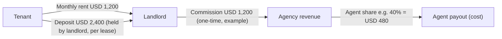
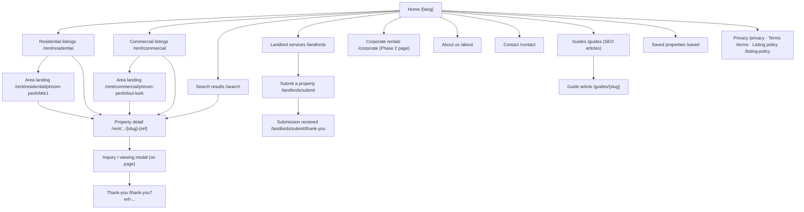
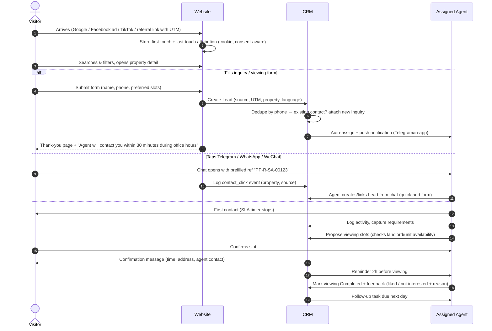
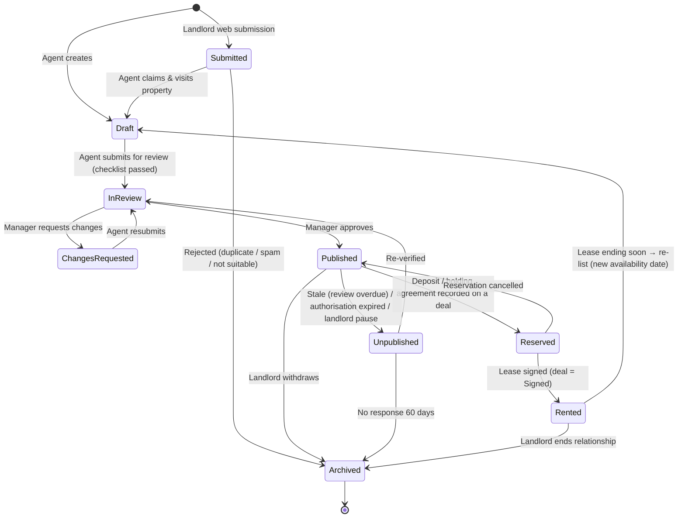
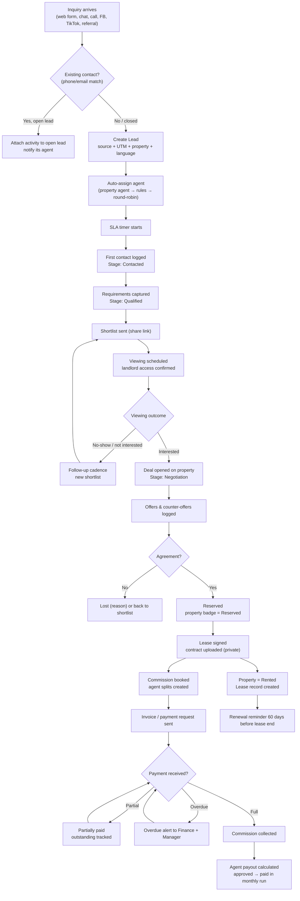
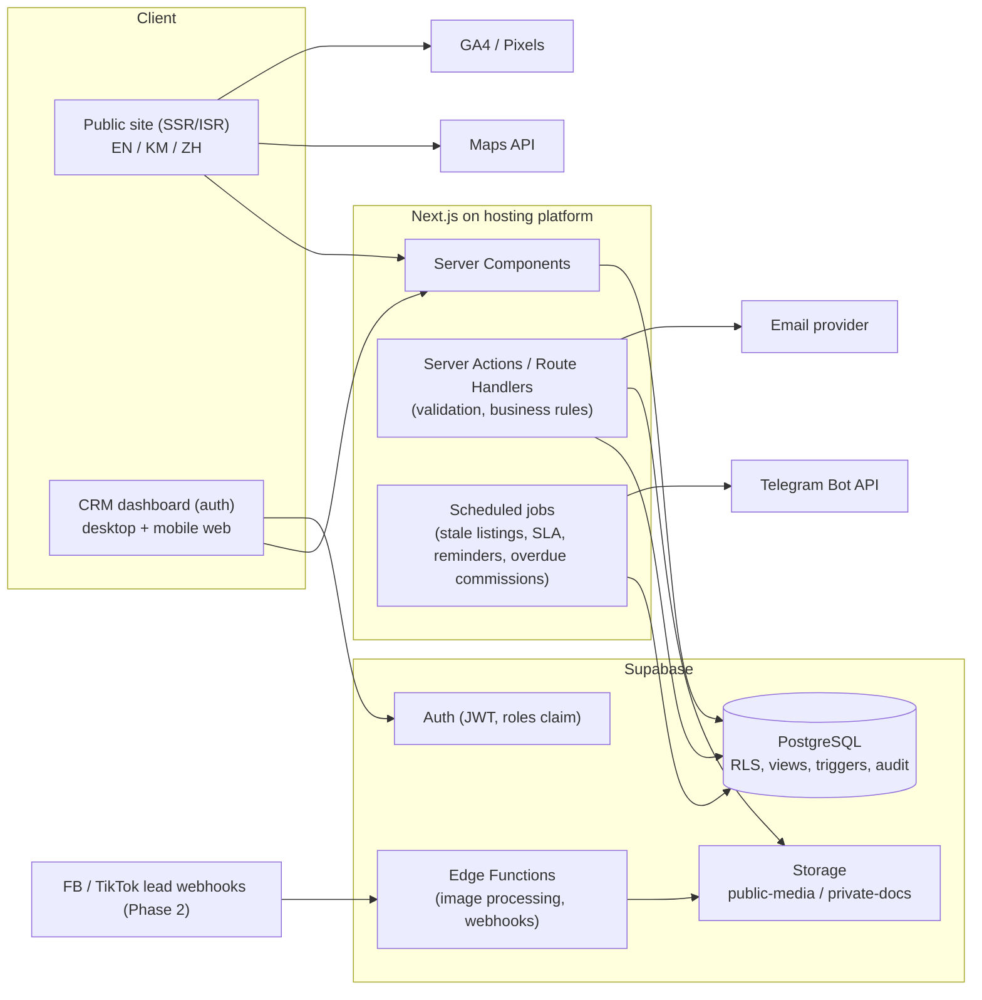
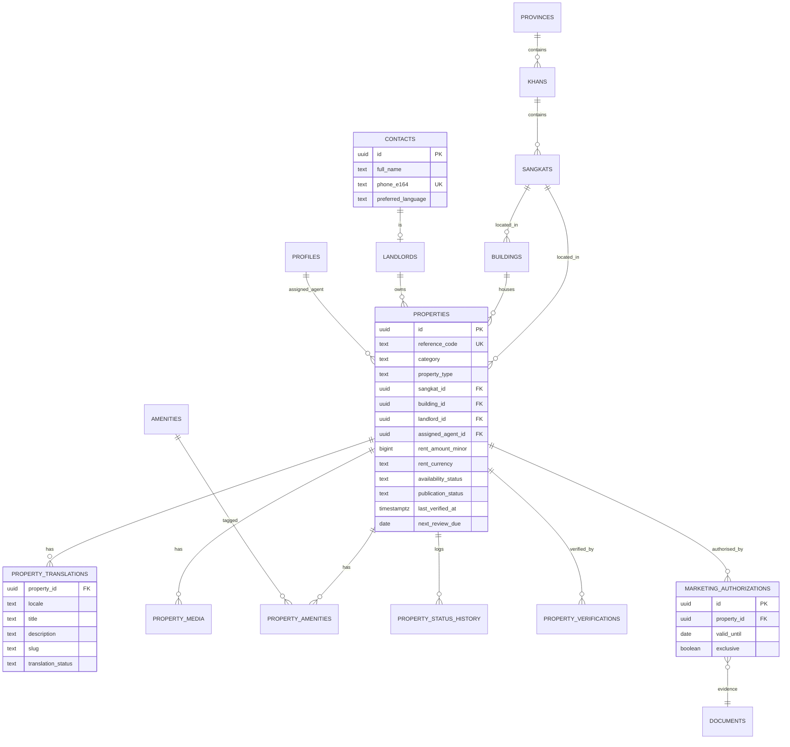
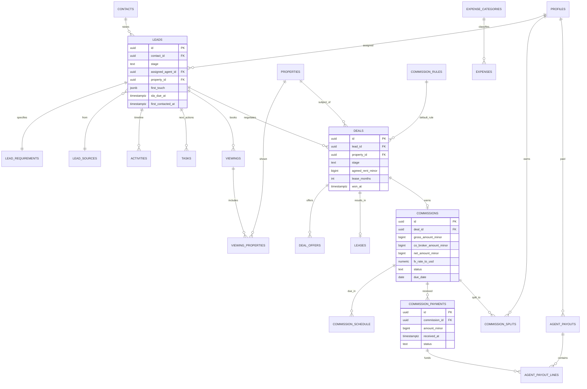
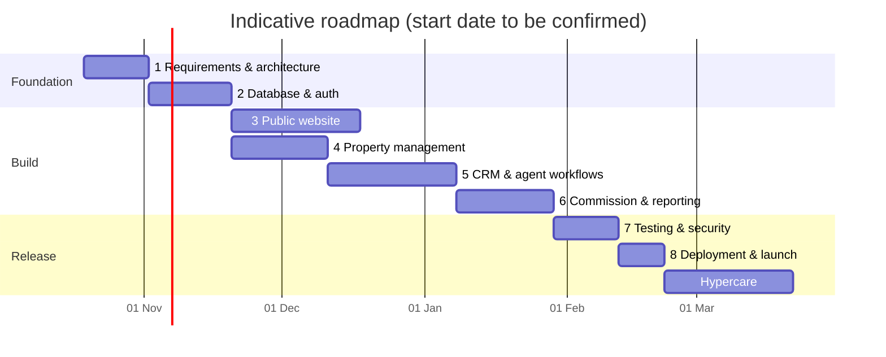

# Cambodia Property Rental Agency — Website + CRM Blueprint

| Item | Value |
|---|---|
| Document | `CAMBODIA_PROPERTY_RENTAL_AGENCY_BLUEPRINT.md` |
| Version | 0.1 (planning draft, no code) |
| Date | 10 October 2026 |
| Status | For owner review. Assumptions and open decisions are listed in Appendix A and Appendix B |
| Working name | "the Agency". The brand name, domain and logo are still open (see Appendix B, D-01) |
| Repository | No existing repository was available when this was drafted. The blueprint assumes a new project |

### How to read this document

- **MUST**: required for launch. **SHOULD**: strongly recommended for launch. **COULD**: later phase.
- Items marked **[ASSUMPTION]** are planning defaults that the owner should confirm.
- Items marked **[VERIFY]** depend on Cambodian law, tax rules, or vendor pricing. They need professional or vendor confirmation before anyone relies on them.
- Prices in this document are **planning estimates**, not quotes. None of them were checked against vendor price lists on the date of writing.
- This document makes no claims about market size or market share. No market statistics are included because none were provided or verified.

---

## Table of Contents

1. [Executive Summary](#section-1-executive-summary)
2. [Business Model](#section-2-business-model)
3. [User Roles](#section-3-user-roles)
4. [Website Sitemap](#section-4-website-sitemap)
5. [UI/UX Design Blueprint](#section-5-uiux-design-blueprint)
6. [Public Website Pages](#section-6-public-website-pages)
7. [Property Management System](#section-7-property-management-system)
8. [CRM Blueprint](#section-8-crm-blueprint)
9. [Agent Performance Management](#section-9-agent-performance-management)
10. [Database and System Architecture](#section-10-database-and-system-architecture)
11. [Financial Dashboard](#section-11-financial-dashboard)
12. [Multilingual System](#section-12-multilingual-system)
13. [Security and Access Control](#section-13-security-and-access-control)
14. [SEO and Marketing](#section-14-seo-and-marketing)
15. [Development Roadmap](#section-15-development-roadmap)
16. [Budget and Operating Costs](#section-16-budget-and-operating-costs)
17. [Risks and Recommendations](#section-17-risks-and-recommendations)
18. [Final Implementation Plan (Backlog)](#section-18-final-implementation-plan-backlog)
- [Appendix A — Assumptions](#appendix-a--assumptions)
- [Appendix B — Unresolved Decisions](#appendix-b--unresolved-decisions)
- [Appendix C — Cambodia Legal & Professional Review Checklist](#appendix-c--cambodia-legal--professional-review-checklist)
- [Appendix D — Glossary](#appendix-d--glossary)

---

## Section 1: Executive Summary

### 1.1 The business

The Agency is a Phnom Penh rental agency with its own team of agents. It rents out:

- **Residential property**: apartments, condos, serviced apartments, villas, and houses (including flats and link houses).
- **Commercial property**: offices, retail shops, shophouses, warehouses, and other commercial spaces.

It earns money mainly from **rental commissions**. Later it will add **property management fees** and **corporate rental services**, such as housing programmes for companies that relocate staff to Cambodia.

### 1.2 What we are building

There are two systems. They share one database.

| System | Audience | Core job |
|---|---|---|
| **Public website** (EN / KM / ZH) | Tenants, landlords, corporate HR/relocation staff | Show verified available properties, capture inquiries and viewing requests, capture landlord submissions, and build trust |
| **Private CRM dashboard** | Owner, managers, agents, marketing, finance | Manage inventory, landlords, leads, viewings, negotiations, deals, commissions, agent activity, and reports |

The most important design choice is that **one property record drives both systems**. When an agent marks a unit "Rented" in the CRM, it comes off the public website at once. When a visitor sends an inquiry, a lead appears in the CRM straight away, already linked to that property, with its source recorded.

### 1.3 Target customers

| Segment | Typical need | Preferred language / channel [ASSUMPTION] |
|---|---|---|
| Expatriate professionals and families | Furnished condos, serviced apartments, villas near international schools | English; WhatsApp, Telegram, email |
| Chinese-speaking tenants and businesses | Condos, offices, shophouses, warehouses | Simplified Chinese; WeChat, Telegram |
| Cambodian tenants and SMEs | Flats, shophouses, shops, offices | Khmer; Telegram, Facebook Messenger, phone |
| Corporate clients (HR/relocation, NGOs, embassies, factories) | Several units, standard leases, monthly invoicing | English or Chinese; email, Telegram |
| Landlords and developers | Find tenants fast, reliable management, avoid scams | Khmer or Chinese; Telegram, phone |

### 1.4 Competitive advantages to build into the product

These advantages only count if the system enforces them. Each one maps to a feature:

1. **Verified listings.** Every published listing has an agent site visit, a date-stamped availability check, and signed landlord marketing authorisation (Section 7).
2. **Freshness guarantee.** Listings that are not reconfirmed within a set period are automatically hidden. The goal is to fix the market's common problem of stale or fake listings (Section 7.6).
3. **Equal service in three languages.** Content, agents' language skills, and lead routing all support EN, KM, and ZH properly (Section 12).
4. **Fast, accountable response.** Leads are auto-assigned and each has a response timer that managers can see (Section 8).
5. **Clear terms.** Every listing shows deposit, lease terms, and what the rent includes. Landlords are told the commission terms in writing.
6. **Professional operations.** Commission tracking, audit logs, and reports let the agency grow beyond a single owner.

### 1.5 Long-term vision

| Horizon | Goal |
|---|---|
| Year 1 | Become a trusted Phnom Penh rental agency with a disciplined CRM and a verified inventory |
| Year 2 | Launch property management services and a corporate rental desk. Open a second city, for example Siem Reap or Sihanoukville [ASSUMPTION] |
| Year 3+ | Add a landlord portal (statements, occupancy), a tenant portal (maintenance requests), and possibly a partner-agent network with shared commissions |

---

## Section 2: Business Model

### 2.1 Agency revenue vs. rent: the core distinction

> **Rent is not agency revenue.** The tenant pays rent to the landlord. The Agency's revenue is only the commission or fee it earns. The system MUST never add rent amounts into revenue figures.



In this example:
- The lease is worth **USD 14,400** (12 × 1,200). This is the **Lease Contract Value**. It is reported only as a volume metric, never as revenue.
- **Agency revenue (booked)** is **USD 1,200**.
- **Agent payout** is **USD 480**. It is a cost of revenue.
- **Agency gross margin on the deal** is **USD 720**.

### 2.2 Revenue streams

| # | Stream | Who pays | How it is earned | When recognised in the system | Phase |
|---|---|---|---|---|---|
| R1 | Leasing commission (residential) | Usually landlord [ASSUMPTION / VERIFY market practice] | Rule-based. A common pattern is a fraction of one month's rent that depends on lease length (see 2.3) | **Booked** when the lease is signed. **Collected** when cash is received | Launch |
| R2 | Leasing commission (commercial) | Landlord, tenant, or both, by agreement | Months of rent or a percentage of first-year rent, by agreement | Same as R1 | Launch |
| R3 | Tenant-side finder fee | Tenant (usually corporate) | Fixed fee or % agreed in writing | Same as R1 | Launch (rare) |
| R4 | Property management fee | Landlord | % of rent collected each month, or a fixed monthly fee | Monthly, when invoiced/collected | Phase 2 business |
| R5 | Corporate rental service fee | Corporate client | Retainer, per-placement fee, or a margin on master leases | Per contract | Phase 2–3 business |
| R6 | Renewal commission | Landlord | Smaller commission when a lease the Agency placed is renewed [ASSUMPTION] | When the renewal is signed | Launch (tracked) |
| R7 | Ancillary services (future) | Either | Move-in inspection, utility setup, furniture packages, cleaning referrals | Per invoice | Future |

### 2.3 Commission rules engine (configurable, not hard-coded)

Commission terms differ between landlords and deals. The CRM MUST therefore store a **commission rule on each deal** and copy the default from a rules table.

| Rule ID | Applies to | Basis | Default value [ASSUMPTION — to confirm with owner] |
|---|---|---|---|
| CR-RES-12 | Residential, lease ≥ 12 months | Months of monthly rent | 1.0 month |
| CR-RES-06 | Residential, 6–11 months | Months of monthly rent | 0.5 month |
| CR-RES-SHORT | Residential, < 6 months | Fixed or % | Owner decides case by case |
| CR-COM-STD | Commercial, ≥ 12 months | Months of monthly rent | 1.0 month (negotiable) |
| CR-COM-LONG | Commercial, ≥ 36 months | Months of monthly rent | Custom |
| CR-MGMT | Managed properties | % of monthly rent collected | Custom (e.g. 8–10%) [ASSUMPTION] |

Rules the system MUST follow:
1. When a deal is created, the default rule is copied onto it. A Manager or higher can override it, and must enter a reason. The override is written to the audit log.
2. The commission is **calculated from the agreed rent** written into the deal, not the advertised price.
3. If the landlord pays in instalments, the deal has a **payment schedule** with one row per instalment.
4. **Co-broking**: if an outside agent shares the deal, the external party's share is recorded separately. Agency revenue is net of that share.

### 2.4 Agent compensation (cost side)

| Item | Default [ASSUMPTION] | System behaviour |
|---|---|---|
| Base salary | Fixed monthly | Recorded as an operating expense (payroll category), not per deal |
| Commission split | Tiered, e.g. 30% / 40% / 50% depending on monthly collected revenue | Calculated on **collected** commission, not booked |
| Listing credit | e.g. 10% of the agency share goes to the agent who sourced the property (if a different agent closed the deal) | Splits per deal, editable by Manager |
| Payout timing | Monthly, after the landlord's payment clears | A payout is created only once a commission payment is marked "Cleared" |
| Clawback | If the lease ends early and commission is refunded | A negative payout adjustment is linked to the original deal |

### 2.5 Operating costs (categories the finance module must support)

| Category | Examples |
|---|---|
| Payroll | Agent base salaries, admin staff, NSSF contributions [VERIFY] |
| Commission payouts | Agent commission shares (cost of revenue) |
| Office | Rent, utilities, internet, cleaning |
| Transport | Fuel, motorbike/tuk-tuk, Grab/PassApp, vehicle upkeep |
| Marketing | Facebook/TikTok/Google ads, boosted posts, signage, print |
| Content | Photography, videography, drone, translation |
| Technology | Hosting, database, domain, email, maps API, SMS, software licences |
| Professional fees | Lawyer, accountant, licensing |
| Taxes & licences | Business licence, patent tax, other taxes [VERIFY] |
| Miscellaneous | Bank fees, entertainment, gifts |

### 2.6 Future revenue streams (evaluate later, not built at launch)

- Featured listing fees for landlords. These carry trust risk, so they would need clear labelling.
- Rent collection and payment processing. This may need financial licensing [VERIFY].
- Furniture packages and fit-out referrals for commercial tenants.
- Data-driven rental market reports, using only the Agency's own aggregated and anonymised data.
- Short-term rental management. Licensing differs and needs checking [VERIFY].

---

## Section 3: User Roles

### 3.1 Role definitions

| Role | Who | Responsibilities | Data scope |
|---|---|---|---|
| **Super Admin / Owner** | Business owner (1–2 people) | Full control, system settings, commission rules, user management, final approvals, financial data | Everything |
| **Agency Manager** | Team lead / branch manager | Assign leads, approve listings for publication, approve commission overrides, review agent performance, manage viewings calendar | Everything in their team/branch; no system settings; read-only finance summaries for their team |
| **Rental Agent** | Field agents | Collect properties, contact landlords, handle assigned leads, book and run viewings, log activities, negotiate, create deals | Own leads, own deals, all **published** properties, unpublished properties they created or are assigned to; landlord contact details only for properties they are assigned to |
| **Marketing Staff** | Content/ads staff | Edit listing copy and translations, manage photos, SEO fields, campaigns, UTM links, see lead-source analytics | Properties (marketing fields only); lead counts and source stats; **no** individual tenant contact details by default; no landlord contacts; no finance |
| **Finance Staff** | Accountant/bookkeeper | Record commission invoices and payments, agent payouts, expenses, produce financial reports | Deals (financial fields), commissions, payouts, expenses; read-only lead/property summary; no editing of property/lead data |
| **Public Visitor** | Anyone | Search, view listings, save favourites (local only at launch), submit inquiry/viewing request | Published listings only |
| **Landlord (submitting)** | Property owner or their representative | Submit a property via the public form; later: landlord portal | Their own submission (via a confirmation link); no CRM access at launch |

### 3.2 Permission matrix

Legend: **C** = create, **R** = read, **U** = update, **D** = delete or archive, **A** = approve, **—** = no access, *(own)* = only records assigned to or created by the user, *(team)* = only the user's team.

| Resource | Owner | Manager | Agent | Marketing | Finance | Visitor | Landlord |
|---|---|---|---|---|---|---|---|
| Published listings | CRUDA | CRUDA (team) | R; U (own) | R; U (marketing fields) | R | R | — |
| Draft / pending listings | CRUDA | CRUDA (team) | CRU (own) | RU (marketing fields) | — | — | C (submission only) |
| Landlord records & contacts | CRUD | CRUD (team) | CRU (own properties) | — | R (name, payment details only) | — | — |
| Landlord private documents (title, ID, authorisation) | CRUD | R (team) | C; R (own) | — | R (only for invoicing) | — | C (upload at submission) |
| Leads / tenant contacts | CRUD | CRUD (team) | CRU (own) | R (aggregated only) | R (name on deal only) | C (via forms) | — |
| Lead assignment / reassignment | ✔ | ✔ (team) | — (can request transfer) | — | — | — | — |
| Activities & tasks | CRUD | CRUD (team) | CRU (own); no delete after 24 h | — | — | — | — |
| Viewings | CRUD | CRUD (team) | CRU (own) | — | — | C (request) | — |
| Deals / negotiations | CRUDA | CRUA (team) | CRU (own, until "Signed") | — | R | — | — |
| Commission rules | CRUD | R | R | — | R | — | — |
| Commission override on a deal | A | A (within limit e.g. ±20%) [ASSUMPTION] | Request only | — | R | — | — |
| Commission payments received | CRUD | R (team) | R (own deals) | — | CRUD | — | — |
| Agent payouts | CRUDA | R (team) | R (own) | — | CRU | — | — |
| Expenses | CRUDA | C (team expenses, needs approval) | C (own claims) | C (marketing claims) | CRUD | — | — |
| Financial reports | R (all) | R (team summary) | R (own earnings) | — | R (all) | — | — |
| Agent performance reports | R (all) | R (team) | R (own) | — | — | — | — |
| Marketing analytics | R | R | — | R | R | — | — |
| Users & roles | CRUD | R (team), invite agents (Owner approves) | — | — | — | — | — |
| System settings, audit log | CRUD / R | R (audit log of team) | — | — | R (financial audit trail) | — | — |
| Data export (CSV) | ✔ | ✔ (team, logged) | — | ✔ (aggregated only) | ✔ (finance only, logged) | — | — |

### 3.3 Role rules

- A user has exactly **one primary role**. A small business may need one person to wear two hats, for example Owner and Finance. That person should be given the higher-privilege role. Do not grant two roles at once in v1.
- **Agents never delete** leads, deals, or properties. They can only request archive, and a Manager approves it.
- Every **export** is logged. Bulk contact exports need Owner or Manager role.
- **Landlord submissions** enter the CRM with status `Submitted`. Nothing a landlord submits goes on the public site without an agent visit and Manager approval.

---

## Section 4: Website Sitemap

### 4.1 URL strategy

- Language prefix on every public URL: `/en/...`, `/km/...`, `/zh/...` (see Section 12).
- Path slugs are written in English in every language, for stability and simpler URLs [ASSUMPTION; see D-07]. Page titles and content are translated.
- Listing URL pattern: `/{lang}/rent/{category}/{city}/{area}/{slug}-{ref}`
  Example: `/en/rent/residential/phnom-penh/bkk1/2-bedroom-serviced-apartment-pp-r-sa-00123`

### 4.2 Public website sitemap



### 4.3 Public page purpose table

| Page | Purpose | Primary CTA | Navigates to |
|---|---|---|---|
| Home | Make the brand's trust promise clear; get the visitor searching quickly | Search bar | Search results, category listings, featured properties, landlord services |
| Residential listings | Browse homes with residential filters | Open a property | Property detail, area landings |
| Commercial listings | Browse commercial spaces with commercial filters (size, frontage, power) | Open a property | Property detail |
| Area landing pages | SEO entry pages per district (e.g. BKK1, Toul Kork, Daun Penh) with area guide text and listings | Open a property | Property detail, guides |
| Search results | Results for any combination of filters, list + map | Open a property / save search (future) | Property detail |
| Property detail | Full facts and photos; convert to inquiry/viewing | "Request viewing" / Telegram / WhatsApp / WeChat | Thank-you, similar listings |
| Saved properties | Device-local favourites, compare up to 3 | "Ask about these" (multi-property inquiry) | Property detail |
| Landlord services | Explain leasing and management services, commission terms summary, process | "List your property" | Submit a property |
| Submit a property | Capture landlord + property details and photos | Submit | Submission thank-you |
| Corporate rentals | Explain services for companies; capture corporate inquiries | "Talk to our corporate desk" | Contact form (corporate type) |
| About us | Team, licence info [VERIFY], office, values, verification process | Contact | Contact, listings |
| Contact | All channels, office map, opening hours, general form | Send message | Thank-you |
| Guides | SEO content: moving to Phnom Penh, area guides, lease checklist | Browse listings | Listings, area landings |
| Privacy / Terms / Listing policy | Legal pages; explain data use and listing verification | — | — |
| Thank-you pages | Confirm submission, set expectations (response time), conversion tracking | Continue browsing | Listings |
| 404 / listing unavailable | When a listing is rented/archived: show "No longer available" + similar listings (keeps SEO value) | View similar | Listings |

### 4.4 Private dashboard sitemap

```mermaid
flowchart TD
    LOGIN["/admin/login"] --> DASH["/admin — Role-based home"]
    DASH --> PROP["Properties /admin/properties"]
    PROP --> PNEW["New property /admin/properties/new"]
    PROP --> PVIEW["Property record /admin/properties/[id]"]
    PROP --> PREV["Review queue /admin/properties/review"]
    PROP --> PSUB["Landlord submissions /admin/properties/submissions"]
    PROP --> PSTALE["Availability checks due /admin/properties/stale"]
    DASH --> LL["Landlords /admin/landlords"]
    LL --> LLV["Landlord record /admin/landlords/[id]"]
    DASH --> LEADS["Leads /admin/leads (list + kanban)"]
    LEADS --> LEADV["Lead record /admin/leads/[id]"]
    DASH --> VIEW["Viewings calendar /admin/viewings"]
    DASH --> DEALS["Deals /admin/deals"]
    DEALS --> DEALV["Deal record /admin/deals/[id]"]
    DASH --> TASKS["My tasks /admin/tasks"]
    DASH --> ACT["Activity log /admin/activity"]
    DASH --> PERF["Performance /admin/performance"]
    PERF --> PERFA["Agent scorecard /admin/performance/[agentId]"]
    DASH --> FIN["Finance /admin/finance"]
    FIN --> FINC["Commissions & receipts /admin/finance/commissions"]
    FIN --> FINP["Agent payouts /admin/finance/payouts"]
    FIN --> FINE["Expenses /admin/finance/expenses"]
    FIN --> FINR["Reports /admin/finance/reports"]
    DASH --> MKT["Marketing /admin/marketing (sources, campaigns, UTM builder)"]
    DASH --> SET["Settings /admin/settings"]
    SET --> SETU["Users & roles"]
    SET --> SETC["Commission rules"]
    SET --> SETL["Locations, amenities, lead sources, lost reasons"]
    SET --> SETA["Audit log"]
```



**Navigation**: there is a left sidebar on desktop. It collapses to icons on tablet and becomes a bottom tab bar on mobile, with Home, Leads, Viewings, Properties, and More. Agents spend most of their day on mobile, so **their mobile experience is the main design target for CRM screens**. Each role sees only the menu items it has permission for (Section 3.2).

---

## Section 5: UI/UX Design Blueprint

### 5.1 Design direction: "Verified calm"

The aim is a premium, quiet, trustworthy look. Many local listing sites are crowded and full of banners. This site will look **clean and editorial**: large photos, generous white space, clear facts, and visible verification badges. The visual identity draws gently on Cambodian materials, such as warm laterite and sandstone tones and the Mekong river. It avoids cliché temple imagery.

Design principles:
1. **Facts before marketing.** Price, location, size, and availability date are always visible above the fold.
2. **Trust is visible.** "Verified on [date]" badges, the agent's photo and name, and the listing reference.
3. **Equal in three languages.** Layouts must hold Khmer text, which is taller, and Chinese text, which is denser, without breaking.
4. **One primary action per screen.**
5. **Fast on mid-range Android phones over 4G** [ASSUMPTION about the majority device profile].

### 5.2 Colour palette (original)

| Token | Hex | Use |
|---|---|---|
| `--color-ink` | `#0B1F2A` | Primary text, footer background |
| `--color-mekong-700` (Primary) | `#0E5E6F` | Primary buttons, links, active states |
| `--color-mekong-500` | `#1F7F91` | Hover, accents, map pins |
| `--color-mekong-50` | `#E8F3F5` | Tinted backgrounds, selected filters |
| `--color-laterite-600` (Accent) | `#B8562E` | Secondary CTA (e.g. "Request viewing" on detail page), highlight badges |
| `--color-sand-50` | `#FAF7F2` | Page background (warm off-white) |
| `--color-sand-200` | `#EDE6DA` | Dividers, card borders |
| `--color-stone-500` | `#6B7280` | Secondary text |
| `--color-success` | `#1E7A4C` | "Available", "Verified", "Collected" |
| `--color-warning` | `#B7791F` | "Reserved", "Due soon", "Partially paid" |
| `--color-danger` | `#B42318` | Errors, "Overdue", "Lost" |
| `--color-info` | `#2F5DA8` | Informational chips |

Every text and background pair MUST meet WCAG 2.1 AA contrast: 4.5:1 for body text and 3:1 for large text and UI elements. Status is never shown by colour alone. Each status chip also has an icon and a text label.

Dark mode: **COULD**, for the CRM only, in a later phase. The public website is light only at launch.

### 5.3 Typography

| Role | Latin | Khmer | Simplified Chinese |
|---|---|---|---|
| Headings | Plus Jakarta Sans (600/700) | Kantumruy Pro (600/700) | Noto Sans SC (600/700) |
| Body / UI | Inter (400/500) | Kantumruy Pro (400/500) | Noto Sans SC (400/500) |
| Numerals in tables | Inter with tabular figures (`font-variant-numeric: tabular-nums`) | Same (Latin digits shown; see 12.6) | Same |

All fonts above are available under open licences through Google Fonts. Confirm the licence when they are adopted [VERIFY].

| Token | Size / line height (Latin & Chinese) | Khmer line height |
|---|---|---|
| Display | 48 / 56 px (desktop), 32 / 40 (mobile) | 1.5× |
| H1 | 36 / 44, 28 / 36 mobile | 1.6× |
| H2 | 28 / 36, 22 / 30 mobile | 1.6× |
| H3 | 20 / 28 | 1.7× |
| Body | 16 / 26 | 1.8× |
| Small | 14 / 20 | 1.8× |
| Caption | 12 / 16 | 1.8× (min 13 px for Khmer legibility) |

Khmer rules:
- Khmer script has stacked subscript consonants and vowels above and below the line. It needs **more line height**, and containers MUST NOT have a fixed height that clips text.
- Khmer does not use spaces between words. Line breaking needs a zero-width-space (ZWSP) or ICU-based segmentation strategy (Section 12.5).
- Load fonts **per language**. A Khmer page loads only the Khmer subset, and a Chinese page only the Chinese subset, so pages stay fast.

### 5.4 Spacing, grid, radius, elevation

- **Spacing scale (4 px base):** 4, 8, 12, 16, 24, 32, 48, 64, 96.
- **Grid:** 12 columns on desktop (max content width 1280 px, 24 px gutters), 8 on tablet, 4 on mobile (16 px side margins).
- **Radius:** 8 px for inputs and buttons, 12 px for cards, 16 px for modals, full radius for chips.
- **Elevation:** cards have a 1 px `sand-200` border and no shadow at rest. On hover they get `0 8px 24px rgba(11,31,42,0.08)`. Modals use a stronger shadow.

### 5.5 Breakpoints

| Name | Min width | Typical device |
|---|---|---|
| `sm` | 0 | Phones |
| `md` | 768 px | Tablets portrait |
| `lg` | 1024 px | Tablets landscape / small laptops |
| `xl` | 1280 px | Desktop |

### 5.6 Components

#### Buttons

| Variant | Style | Use |
|---|---|---|
| Primary | `mekong-700` fill, white text, 44 px min height | Main action per screen (Search, Submit, Save) |
| Accent | `laterite-600` fill | "Request viewing" on property detail only |
| Secondary | White fill, `mekong-700` 1 px border and text | Secondary actions |
| Ghost | Text only | Tertiary actions, table row actions |
| Messaging | Brand-neutral icon + label ("Telegram", "WhatsApp", "WeChat") | Contact buttons on detail page |
| Destructive | `danger` outline; filled only in a confirm dialog | Archive, cancel deal |

All buttons have default, hover, focus (2 px focus ring, `mekong-500`), active, disabled, and loading (spinner, label kept) states. The minimum touch target is 44 × 44 px.

#### Property card (public)

```
┌──────────────────────────────┐
│ [Photo 4:3, lazy-loaded]     │
│ ● Verified 3 Oct   ♡ Save    │  ← badge overlay top-left, save top-right
├──────────────────────────────┤
│ USD 1,200 / month            │  ← price, H3, tabular nums
│ 2-Bed Serviced Apartment     │  ← title (1 line, ellipsis)
│ BKK1, Chamkarmon             │  ← area, district
│ 🛏 2  🛁 2  ⬚ 95 m²  Furnished │  ← key facts row (icons + text)
│ Available from 1 Nov 2026    │  ← availability
└──────────────────────────────┘
```
Commercial cards swap bedrooms and bathrooms for **floor area, floors, frontage width, and parking**.

#### Tables (CRM)

- Sticky header, zebra rows with `sand-50`, row height 48 px (compact mode 36 px).
- Columns can be sorted. Users can show or hide columns, and the column setup is saved per user.
- Numbers are right-aligned with tabular figures. Each money column shows its currency code.
- Users can tick rows for bulk actions (assign, change status). Bulk actions depend on permissions.
- On mobile, tables turn into **stacked cards** with the 3–4 most important fields.

#### Forms

- Labels sit above fields, never as placeholders only. Required fields are marked with "*" and a text explanation.
- Fields are validated inline when the user leaves them, with the error message under the field in `danger`.
- Phone fields default to Cambodia (+855), handle numbers with or without the leading zero, and normalise to E.164 format.
- Long forms (property create, landlord submission) are split into **steps with a progress indicator** and autosave drafts.
- Multilingual text fields show **EN | KM | ZH tabs**, each with a completion dot.

#### Navigation

- **Public header (desktop):** logo · Residential · Commercial · Landlords · About · Contact · language switcher (EN / ខ្មែរ / 中文) · "List your property" (secondary button).
- **Public header (mobile):** logo · search icon · language switcher · hamburger menu.
- **Sticky contact bar on mobile property detail:** Telegram · WhatsApp/WeChat · Request viewing.

#### Other components

Filter chips, range sliders (price, size), a map with clustered pins, a photo gallery (swipe on mobile, lightbox on desktop), a status chip, a KPI tile, a timeline (activity history), a kanban column, a calendar (day, week, agenda), a toast, a confirm dialog, an empty state with an illustration and next action, and skeleton loaders.

### 5.7 Responsive layouts

**Homepage**

```
DESKTOP (≥1280)                          TABLET (768–1279)            MOBILE (<768)
┌───────────────────────────────────┐    ┌──────────────────────┐     ┌────────────┐
│ Header                            │    │ Header               │     │ Header ☰   │
├───────────────────────────────────┤    ├──────────────────────┤     ├────────────┤
│ HERO photo + headline             │    │ HERO                 │     │ HERO short │
│ [Res|Com] [Area▼][Type▼][Budget▼][🔍]│  │ Search (2 rows)      │     │ Search     │
├───────────────────────────────────┤    ├──────────────────────┤     │ (stacked)  │
│ Featured: 4 cards in a row        │    │ 2 cards per row      │     ├────────────┤
├───────────────────────────────────┤    ├──────────────────────┤     │ 1 card,    │
│ Browse by area: 6 tiles           │    │ 3 tiles per row      │     │ h-scroll   │
├───────────────────────────────────┤    ├──────────────────────┤     ├────────────┤
│ How we verify (3 steps)           │    │ 3 steps              │     │ stacked    │
│ Landlord CTA band                 │    │                      │     │            │
│ Footer                            │    │ Footer               │     │ Footer     │
└───────────────────────────────────┘    └──────────────────────┘     └────────────┘
```

**Search results**

- **Desktop:** filter sidebar (280 px) · result list (2-column cards) · toggleable map panel on the right (sticky).
- **Tablet:** filters in a slide-over drawer · 2-column list · "Map" toggle switches to a full-width map.
- **Mobile:** "Filters (3)" button opens a full-screen sheet · 1-column list · floating "Map" toggle button.

**Property detail**

- **Desktop:** gallery grid (1 large + 4 small) · two columns: content (left, 8 cols) and a **sticky inquiry card** (right, 4 cols) with price, agent, and CTAs.
- **Tablet:** gallery carousel · single column · inquiry card after the key facts.
- **Mobile:** swipe gallery · key facts · description · **sticky bottom contact bar**.

**CRM dashboard**

- **Desktop:** sidebar + content area with KPI tiles row + tables.
- **Tablet:** collapsed icon sidebar.
- **Mobile:** bottom tab bar. Lead and viewing records use a card layout with **one-tap call, Telegram, and "log activity" buttons**.

### 5.8 Accessibility (MUST)

- WCAG 2.1 AA target.
- Everything can be done by keyboard, with visible focus.
- Every image has alt text. Property photos get auto-generated alt text, e.g. "Living room — 2-bedroom apartment, BKK1", which agents can edit.
- Each page sets its language with `lang="en" | "km" | "zh-Hans"`.
- Users with reduced-motion settings see no animation.

---

## Section 6: Public Website Pages

### 6.1 Homepage

| Block | Content | Behaviour |
|---|---|---|
| Header | See 5.6 | Sticky on scroll (compact height) |
| Hero | Full-width photo (rotating from the Owner-curated set), headline e.g. "Verified rentals in Phnom Penh", sub-headline | Text translated per language; photos curated in CMS |
| Search bar | Tabs: Residential / Commercial · Area (multi-select with autocomplete over Khan/Sangkat/popular area names) · Property type · Budget (min–max USD) · Bedrooms (residential) or Size m² (commercial) · Search | Goes to `/search?...` with query params; remembers last search on device |
| Featured listings | 8 listings chosen by Manager ("featured" flag), must be published & verified < 14 days | Carousel on mobile; "View all" → search |
| Browse by area | Tiles for top areas with photo and live count of available listings | Links to area landing pages |
| Browse by type | Apartments, Condos, Villas, Serviced apartments, Offices, Shophouses, Warehouses | Links to filtered search |
| How we verify | 3 steps: Agent visits → Landlord authorises → Availability rechecked every 14 days | Links to Listing policy |
| Landlord CTA | "Rent your property with us" + benefits | → Landlord services |
| Corporate CTA (Phase 2) | "Housing for your team" | → Corporate page |
| Latest guides | 3 articles | → Guides |
| Footer | Contacts, office address, opening hours, social links, language switcher, legal links, licence number [VERIFY] | — |

### 6.2 Residential listings page

- **Filters:** area, property type (apartment, condo, serviced apartment, villa, house, flat), price range, bedrooms (Studio, 1, 2, 3, 4+), bathrooms, furnishing (fully, partly, unfurnished), pet-friendly, available by date, amenities (pool, gym, parking, lift, generator/backup power, security 24/7, balcony, washing machine), lease term (≥ 6 months, ≥ 12 months), "includes utilities/cleaning".
- **Sort:** recommended (default: verified recency + quality score), price low to high, price high to low, newest, size.
- **List:** 24 per page, with pagination links that work for SEO, plus "Load more" on mobile.
- **Empty state:** "No exact matches. Tell us what you need and an agent will search for you" opens a **requirements form**, which creates a lead.

### 6.3 Commercial listings page

The layout is the same. Filters differ:
- **Type:** office, retail shop, shophouse, warehouse, commercial space/land-with-building [ASSUMPTION], co-working (later).
- **Size:** floor area m² (min/max), number of floors, frontage width (m), ceiling height (warehouse), loading access (truck/container), power supply (3-phase, kVA), parking spaces, fit-out condition (bare, fitted, fully furnished office), road type (main road/street) [ASSUMPTION about relevant attributes].
- **Price:** shown as monthly rent. For offices and warehouses, also shown as **USD/m²/month** (calculated).

### 6.4 Search results page

- Combines both categories when the visitor uses a general search.
- The URL holds all filter state, so links can be shared, the back button works, and pages can be analysed.
- **Map:** clustered pins. A pin shows the price, and clicking it opens a mini card. **Location privacy:** pins sit at the **approximate location** (offset ~150–300 m) unless the landlord has authorised the exact location (Section 7.2).
- Filter combinations that have useful landing pages (area + type) get `<link rel="canonical">` to those pages. Other combinations are `noindex,follow` (Section 14).

### 6.5 Property detail page

| Block | Content |
|---|---|
| Breadcrumb | Home › Residential › Phnom Penh › BKK1 › Listing |
| Gallery | Up to 30 photos, video (hosted or YouTube embed), optional floor plan, 360° link (later) |
| Title + reference | Translated title, reference `PP-R-SA-00123`, "Verified on 3 Oct 2026 by [Agent]" |
| Price block | Monthly rent (USD), KHR equivalent optional (indicative, see 10.9), what's included (e.g. "Includes cleaning 2×/week, internet"), deposit (e.g. "2 months"), minimum lease, advance payment |
| Key facts | Type, bedrooms, bathrooms, floor area, floor level, furnishing, availability date, pets, parking |
| Description | Translated description (with "Translated from English" note if auto-generated/unverified, see 12.4) |
| Amenities | Icon grid (building + unit amenities) |
| Location | Map (approximate), area name, nearby landmarks (manually entered list: schools, malls, hospitals) |
| Costs & utilities | Electricity rate type (state rate vs landlord rate) [ASSUMPTION — common local question], water, internet, service/management fee |
| Agent card | Photo, name, languages spoken, Telegram/WhatsApp/WeChat buttons, phone (click-to-call), "Request viewing" |
| Inquiry form | Name, phone (+855 default) or email, preferred contact app, preferred viewing dates (up to 3 slots), message, consent checkbox; honeypot + Turnstile |
| Similar properties | 4 listings: same area/type, ±20% price |
| Unavailable state | If status is Reserved: banner "Reserved — similar units below", inquiry still possible ("join backup list"). If Rented/Archived: page returns HTTP 200 with "No longer available" + similar listings for 90 days, then 410 or redirect to area page [ASSUMPTION] |

**Messaging buttons**: each one opens the app with a **pre-filled message that includes the listing reference**, for example "Hello, I'm interested in PP-R-SA-00123". Inbound chats can then be matched to listings. Each click is recorded as a `contact_click` analytics event, with an optional, lighter-weight "lead shell" (Section 8.2).

### 6.6 About us

The page covers the company story, team (photos, languages, specialisation), the verification process explained in detail, office photos and address, business registration and licence numbers [VERIFY what can and must be displayed], and testimonials. Testimonials are only published with written consent and must never be fabricated.

### 6.7 Contact us

The page shows a contact form with a type selector (Tenant / Landlord / Corporate / Other), the office map, opening hours, phone, Telegram, WhatsApp, WeChat ID or QR code, email, and Facebook. The selected type decides lead routing.

### 6.8 Submit a property (landlord)

A multi-step form with draft autosave:
1. **About you:** name, role (owner / authorised representative / developer / other agent), phone, contact app, email, preferred language.
2. **Property:** category, type, address (Province → Khan → Sangkat → street/house no./building name), unit details, asking rent, availability date.
3. **Photos:** up to 20 images, 10 MB each, compressed on the client. Optional at submission.
4. **Terms:** expected deposit, minimum lease, what's included. A consent checkbox lets the Agency contact them and market the property after verification. A link to the commission terms summary is shown.
5. **Review & submit.**

After submission:
- The record is created with status `Submitted`. The landlord gets an acknowledgement through their chosen channel. Email comes first; Telegram bot messages and SMS are later options.
- The system checks for duplicates by phone, address, and building/unit number. Possible duplicates are flagged for the Manager.
- The landlord is **never** published automatically.

### 6.9 Landlord services

The page explains:
- **Leasing service:** marketing, viewings, tenant screening, lease preparation support, handover inspection.
- **Management service (Phase 2):** rent collection support, maintenance coordination, periodic inspections, monthly statement.
- Commission and fee summary, or "contact us for terms" (see D-04).
- The process timeline, FAQs, and a CTA to submit a property.

### 6.10 Privacy policy, Terms of use, Listing policy

These pages are drafted by the Agency and **reviewed by a Cambodian lawyer** [VERIFY]. Section 13 and Appendix C give the topics to cover: data collected, purposes, retention, sharing with landlords, cookies/analytics, how to request deletion, the listing accuracy disclaimer, and the verification policy.

### 6.11 Visitor journey: discovery to viewing



---

## Section 7: Property Management System

### 7.1 Reference codes

Format: `{CITY}-{CAT}-{TYPE}-{SEQ}`

| Part | Values |
|---|---|
| CITY | `PP` Phnom Penh, `SR` Siem Reap, `SV` Sihanoukville, `BB` Battambang, … (configurable) |
| CAT | `R` Residential, `C` Commercial |
| TYPE | `AP` Apartment, `CD` Condo, `SA` Serviced apartment, `VL` Villa, `HS` House, `FL` Flat, `OF` Office, `SH` Shop, `SP` Shophouse, `WH` Warehouse, `CS` Commercial space |
| SEQ | 5-digit sequence per city (not per type, to keep it simple and unique) |

Example: `PP-R-SA-00123`. A reference is **never reused**, including after archive. If an agent recategorises a property, it keeps its original reference, and the old code is kept as an alias.

### 7.2 Property data structure

**A. Identity and classification**

| Field | Type | Required | Notes |
|---|---|---|---|
| `id` | UUID | ✔ | Internal primary key |
| `reference_code` | text, unique | ✔ | Auto-generated (7.1) |
| `category` | enum `residential`/`commercial` | ✔ | |
| `property_type` | enum (see TYPE list) | ✔ | |
| `building_id` | FK → buildings | — | Condo/serviced apartment buildings shared across units (amenities, address, photos of common areas) |
| `unit_label` | text | — | e.g. "Unit 12B" — **private** (not shown publicly by default) |
| `parent_property_id` | FK → properties | — | For multi-unit listings (e.g. "3 identical units available") [COULD] |

**B. Multilingual content** (stored in `property_translations`, one row per language)

| Field | Type | Required | Notes |
|---|---|---|---|
| `locale` | enum `en`/`km`/`zh-Hans` | ✔ | |
| `title` | text (≤ 90 chars) | EN ✔ | |
| `description` | rich text (limited markdown) | EN ✔ | |
| `slug` | text | ✔ (EN) | Generated from EN title + reference |
| `seo_title`, `seo_description` | text | — | Defaults generated from facts |
| `translation_status` | enum `missing`/`machine`/`reviewed` | ✔ | Controls "translated" notice and SEO indexing (Section 12) |
| `translated_by`, `reviewed_by`, `reviewed_at` | FK/timestamp | — | |

**C. Location**

| Field | Type | Required | Notes |
|---|---|---|---|
| `province_id` | FK | ✔ | Phnom Penh at launch |
| `khan_id` (district) | FK | ✔ | e.g. Chamkarmon |
| `sangkat_id` (commune) | FK | ✔ | e.g. Boeung Keng Kang 1 |
| `area_tag_ids` | many-to-many | — | Marketing areas not identical to admin boundaries ("BKK1", "Riverside", "Diamond Island / Koh Pich") |
| `street`, `house_number`, `building_name` | text | — | `house_number` is **private** |
| `latitude`, `longitude` | numeric | ✔ | Exact, private |
| `public_lat`, `public_lng` | numeric | ✔ | Offset/approximate, generated on save |
| `show_exact_location` | boolean | ✔ (default false) | Requires landlord authorisation |
| `nearby_landmarks` | text[] per locale | — | Manually curated |

**D. Price and terms**

| Field | Type | Required | Notes |
|---|---|---|---|
| `rent_amount_minor` | bigint | ✔ | Integer in minor units (USD cents) |
| `rent_currency` | enum `USD`/`KHR` | ✔ | Default USD [ASSUMPTION] |
| `price_negotiable` | boolean | — | |
| `rent_period` | enum `month` | ✔ | Monthly only at launch |
| `price_per_sqm_minor` | generated | — | Commercial display |
| `deposit_months` | numeric(3,1) | ✔ | e.g. 1, 2, 3 |
| `advance_months` | numeric(3,1) | — | Rent paid in advance |
| `min_lease_months` | int | ✔ | |
| `max_lease_months` | int | — | |
| `included_services` | enum[] | — | cleaning, internet, cable TV, water, electricity, laundry, parking, management fee |
| `electricity_rate_note` | text per locale / enum (`state_rate`, `landlord_rate`, `included`) | — | |
| `service_fee_minor` | bigint | — | Building/management fees not included in rent |
| `commission_rule_id` | FK | ✔ | Default rule for this listing (from landlord agreement) |

**E. Physical attributes**

| Field | Residential | Commercial |
|---|---|---|
| `bedrooms` (0 = studio) | ✔ | — |
| `bathrooms` | ✔ | optional |
| `floor_area_sqm` | ✔ | ✔ |
| `land_area_sqm` | villas/houses | warehouses/shophouses |
| `floor_level`, `total_floors` | ✔ | ✔ |
| `furnishing` (`fully`/`partly`/`unfurnished`; commercial: `bare`/`fitted`/`furnished`) | ✔ | ✔ |
| `frontage_m`, `ceiling_height_m`, `power_capacity_kva`, `three_phase_power`, `loading_access` | — | ✔ |
| `parking_car`, `parking_moto` | ✔ | ✔ |
| `pet_policy` (`no`/`small`/`negotiable`/`yes`) | ✔ | — |
| `year_built_or_renovated` | optional | optional |

**F. Amenities**: a many-to-many link to `amenities` (seeded list with icon and translations, with scope `building` or `unit`).

**G. Media** (`property_media`)

| Field | Notes |
|---|---|
| `type` | `photo`/`video`/`floor_plan`/`virtual_tour_url` |
| `storage_path` | Original stored in **private** bucket; public derivatives (watermarked, resized) in public bucket |
| `sort_order`, `is_cover` | |
| `alt_text` per locale | |
| `taken_at`, `uploaded_by` | Detect stale photos |
| `visibility` | `public`/`internal` (e.g. photos showing house number or landlord's belongings) |

**H. Landlord and authorisation**

| Field | Notes |
|---|---|
| `landlord_id` | FK → landlords (required before publication) |
| `ownership_relationship` | owner / authorised representative / developer / co-broker |
| `marketing_authorization_id` | FK → `marketing_authorizations` (document + validity dates + exclusivity flag). **Publication blocked without valid authorisation** |
| `exclusive` | boolean, `exclusive_until` date |
| `co_broker_id` | Optional external agent |

**I. Status and operations**

| Field | Values / notes |
|---|---|
| `availability_status` | `available`, `available_from` (date), `reserved`, `rented`, `off_market` |
| `publication_status` | `draft`, `submitted`, `in_review`, `changes_requested`, `published`, `unpublished`, `archived` |
| `available_from` | date |
| `assigned_agent_id` | Agent responsible for availability and viewings |
| `listing_agent_id` | Agent who sourced it (for listing credit) |
| `last_verified_at`, `last_verified_by` | Updated by "Confirm availability" action (requires contact log with landlord) |
| `next_review_due` | `last_verified_at + review_interval` (default 14 days residential, 30 days commercial) [ASSUMPTION] |
| `listing_expires_at` | Derived from authorisation validity; listing auto-unpublishes when passed |
| `quality_score` | 0–100 computed (photos count, translations complete, facts complete, verified recency) |
| `featured` | boolean (Manager only) |
| `internal_notes` | Private |
| `created_at`, `updated_at`, `deleted_at` | Soft delete |

### 7.3 Lifecycle



`availability_status` and `publication_status` are **separate**. This matters because a property can be published and reserved at the same time, which shows a "Reserved" badge. The public site shows a listing only if `publication_status = published` **and** `availability_status IN (available, available_from, reserved)`.

### 7.4 Pre-publication checklist (enforced by the system)

When an agent clicks "Submit for review", the system checks:
- [ ] Landlord linked, with a verified phone number
- [ ] Marketing authorisation uploaded and valid (written, signed, or a recorded chat screenshot; see D-05)
- [ ] Agent site visit logged (activity type `property_visit` within the last 30 days)
- [ ] At least 6 public photos, including a cover photo [ASSUMPTION]
- [ ] EN title and description filled in; KM and ZH filled in or marked `machine` (Section 12)
- [ ] Rent, deposit, minimum lease, availability date, and key facts filled in
- [ ] Location set; public pin offset generated
- [ ] No unresolved duplicate warning

Managers approve from a **review queue**. Each item shows the listing preview, a checklist status, and a diff against the previous published version.

### 7.5 Reservation, rental, and archive

- **Reserve:** triggered from a deal when the stage is `Reserved / Holding deposit`. The listing shows a "Reserved" badge and the inquiry form becomes "join backup list".
- **Rent:** triggered when the deal reaches `Lease signed`. The property goes to `rented`. The lease start and end dates are stored on the **lease** record. The system creates a **"re-list reminder"** task for the assigned agent 60 days before the lease ends [ASSUMPTION].
- **Archive:** the property is hidden everywhere except its history. Archived data is never hard-deleted. Old URLs follow the "No longer available" rules.

### 7.6 Availability freshness (anti-stale)

| Day | Event |
|---|---|
| `next_review_due − 2 days` | Task "Confirm availability with landlord" assigned to the agent |
| `next_review_due` | Listing shows "Verifying availability" internally; still public |
| `+3 days overdue` | Listing **auto-unpublished**; Manager notified |
| Agent confirms | Must log contact (call/message) with landlord → `last_verified_at` updated → re-published automatically if nothing else changed; if price/terms changed → goes to review |

### 7.7 Price and change history

Every change to price, availability, or status writes a row to `property_status_history` or `property_price_history`, recording who, when, the old value, the new value, and the reason. This lets the business report average time on market and price reductions, and it supports disputes.

---

## Section 8: CRM Blueprint

### 8.1 Core objects

| Object | Meaning |
|---|---|
| **Contact** | A person or company (tenant, corporate client, landlord). Deduplicated by phone/email |
| **Lead** | One rental need from a contact (a contact can have several over time) |
| **Requirement** | Structured needs on a lead (budget, area, type, beds, move-in date) |
| **Activity** | Any logged interaction: call, message, email, meeting, note, property visit |
| **Task** | A to-do with due date/time and owner; follow-up reminders are tasks |
| **Viewing** | A scheduled visit of one or more properties with a lead |
| **Deal** | A negotiation on a specific property for a specific lead, through to signed lease |
| **Lease** | Signed contract facts (dates, rent, deposit, parties); created from a won deal |
| **Commission** | The amount the Agency is owed for a deal (with schedule) |
| **Commission payment** | Cash actually received |

### 8.2 Lead capture

| Channel | Capture method | Auto fields |
|---|---|---|
| Website inquiry / viewing form | Server action → `leads` | source = `website`, sub-source from UTM, property, locale, page URL, first/last touch |
| Website requirements form ("no results") | Same | source = `website_requirements` |
| Messaging click (Telegram/WhatsApp/WeChat) | Logged as event; agent converts chat to lead via **Quick-add** (mobile, 20 seconds: phone, name, ref, source) | Source pre-selected from referring click if phone matches within 48 h [COULD] |
| Facebook Lead Ads / Messenger | Phase 2: webhook → `leads`; launch: manual quick-add with source `facebook` | campaign, ad set, form id |
| TikTok Lead Generation | Phase 2: webhook/export import; launch: manual | campaign |
| Phone call / walk-in | Quick-add | source = `phone` / `walk_in` |
| Referral | Quick-add with referrer contact | source = `referral`, `referred_by_contact_id` |
| Corporate inquiry | Contact page type = corporate | Routed to corporate desk queue |
| Landlord submission | Creates **landlord contact + property (Submitted)**, not a tenant lead | |

**Deduplication**: phone numbers are normalised to E.164. Cambodian formats like `012 345 678`, `+855 12 345 678`, and `85512345678` all become `+85512345678`. If a contact with that phone exists, the new inquiry is attached as a **new lead or an activity on the open lead**, according to these rules:
- If the contact has an open lead (not Won or Lost) of the same category → add an activity to it and notify its agent.
- Otherwise → create a new lead and assign it to the **previous agent if they are still active** (continuity). If not, use the normal rules.

### 8.3 Lead assignment

Assignment runs in this order:
1. **Property-linked lead** → the property's `assigned_agent_id`, if the agent is active and on shift.
2. **Corporate** → corporate desk queue (Manager or a designated agent).
3. **Rules engine** filtered by:
   - Category specialisation (residential or commercial)
   - Language match (lead locale or preferred language ∈ agent languages)
   - Area coverage (optional)
   - Agent is **available**: on shift and not on leave
4. **Weighted round-robin** among eligible agents. The weight falls if an agent has more than N open uncontacted leads [ASSUMPTION: N = 10].
5. If nobody is eligible → **unassigned queue**, and the Manager is notified.

**Response SLA** [ASSUMPTION; Owner to confirm]:
- During office hours: first contact within **30 minutes**. At 30 minutes the Manager gets a reminder. At 60 minutes the lead is offered for reassignment.
- Outside office hours: by **10:00 the next business day**.
- "First contact" means a logged outbound call, message, or email activity on the lead.

### 8.4 Lead sources

Lead sources form a managed list with a hierarchy: **Channel → Source → Campaign**.

| Channel | Example sources |
|---|---|
| Organic | Google organic, direct, Bing |
| Paid | Google Ads, Facebook Ads, TikTok Ads |
| Social organic | Facebook page, TikTok, Instagram, Telegram channel |
| Messaging | Telegram, WhatsApp, WeChat |
| Offline | Walk-in, signboard, phone, event |
| Referral | Past tenant, landlord, partner, employee |
| Partner | Co-broker agency, relocation company |

On a website lead the system stores `first_touch_*` and `last_touch_*` (utm_source, utm_medium, utm_campaign, utm_content, referrer, landing page, timestamp). Agents may **correct** the source, for example when a visitor says "my friend referred me". The original value is kept in the audit trail.

### 8.5 Customer requirements (structured)

| Field | Example |
|---|---|
| Category / types | Residential; condo or serviced apartment |
| Budget min–max + currency | USD 800–1,300 |
| Areas | BKK1, Toul Tom Poung, Chroy Changvar |
| Bedrooms / size | 2+ bedrooms |
| Must-haves | Pool, gym, pet-friendly |
| Move-in date | 2026-11-15 |
| Lease length | 12 months |
| Occupants, pets | 2 adults, 1 small dog |
| Company paying? | Yes → corporate flag |
| Nationality / language preference | Optional; preferred language required |

The system offers **matching properties**: published listings that fit the hard filters, ranked by soft criteria. The agent can send a shortlist by Telegram, WhatsApp, or email as a **share link** (`/s/{token}`), which shows the selected listings in the client's language. The CRM records which listings were sent and which ones the client opened [COULD: open tracking].

### 8.6 Pipeline stages (lead → deal)

| # | Stage | Entry condition | Required data to leave stage |
|---|---|---|---|
| L1 | New | Created | First contact activity |
| L2 | Contacted | First contact logged | Requirements filled (min: category, budget, area, move-in) |
| L3 | Qualified | Requirements complete; genuine need | Shortlist sent OR viewing scheduled |
| L4 | Viewing scheduled | ≥ 1 viewing booked | Viewing completed with feedback |
| L5 | Viewed | ≥ 1 viewing completed | Deal created (interest in specific property) or more viewings |
| D1 | Negotiation | Deal opened on a property | Offer(s) logged |
| D2 | Reserved | Holding deposit / agreement in principle | Lease draft details |
| D3 | Lease signed (**Won**) | Lease signed date + uploaded contract (private) | Commission record created |
| D4 | Commission invoiced | Invoice/request sent to payer | Payment(s) recorded |
| D5 | Commission collected | Paid in full | Payout calculated |
| X | Lost | Any stage | Lost reason (mandatory) |

**Lost reasons** (managed list): budget too low · found elsewhere (another agency) · found directly with landlord · property rented to someone else · changed plans / not moving · no response after 3 attempts · location not suitable · landlord rejected terms · requirements not available in inventory · duplicate / spam · other (comment required).

The "requirements not available in inventory" reason feeds **inventory gap reports** for agents who source properties, for example "17 lost leads wanted 2-bed under USD 600 in Toul Kork".

### 8.7 Follow-up reminders

- Every open lead MUST have **one future task** (the next action). If an agent closes a task without creating another, they are asked to "schedule next follow-up or mark lost".
- Default cadence after a viewing: day 1, day 3, day 7, then weekly for 4 weeks. After that, auto-suggest "Lost — no response" [ASSUMPTION].
- **My Day** view for agents: overdue tasks (red), today's viewings, today's follow-ups, new leads waiting for first contact.
- Notifications: in-app, plus Telegram bot DMs to staff (Phase 5 deliverable; see D-09). Email is a fallback.

### 8.8 Activity history

Each lead, contact, property, landlord, and deal has a **timeline** of activities, status changes, viewings, offers, documents, and system events. Activity types: `call_out`, `call_in`, `message_out`, `message_in`, `email`, `meeting`, `property_visit`, `viewing`, `note`, `document`, `status_change` (system), `assignment` (system).

Activity fields: type · direction · channel · outcome (`reached`, `no_answer`, `left_message`, `wrong_number`) · summary · related entity · occurred_at · duration (calls) · created_by. Agents can edit their own activities for 24 hours. After that, only Managers can edit, and every edit is audited.

### 8.9 Viewing appointments

| Field | Notes |
|---|---|
| `lead_id`, `agent_id` | |
| `scheduled_start`, `scheduled_end` | Asia/Phnom_Penh time zone |
| `properties[]` | Ordered list (a viewing tour of several units) with per-property feedback |
| `meeting_point` | Address or "at property" |
| `landlord_confirmed` | Checkbox per property (agent confirmed access with landlord/building) |
| `status` | `requested`, `confirmed`, `completed`, `no_show_client`, `cancelled_client`, `cancelled_landlord`, `rescheduled` |
| Per-property feedback | Interest level (1–5), liked, disliked, objection category |
| Optional check-in | Mobile "Check in" button capturing timestamp (+ optional GPS with consent) to support verified activity metrics [COULD; see 9.5] |

Calendar views: an agent's day and week, a manager's team calendar, and a property's viewings. The system warns about clashes when one agent is double-booked.

### 8.10 Negotiation tracking

A deal has an **offers log**:

| Field | Example |
|---|---|
| `offered_by` | tenant / landlord |
| `rent_offered` | USD 1,100 |
| `deposit_months` | 2 |
| `lease_months` | 12 |
| `other_terms` | "Add second AC unit; landlord pays internet" |
| `status` | pending / countered / accepted / rejected |
| `offered_at` | |

The agreed terms are copied onto the deal (`agreed_rent`, `agreed_deposit`, `lease_start`, `lease_months`). The commission amount is then calculated (Section 2.3).

### 8.11 Rental deal management

Once a deal is **Lease signed**, the system:
1. Requires the lease start date, end date, agreed rent, deposit, and payer of commission. Uploading the signed lease to private storage is required.
2. Creates a **lease** record.
3. Sets the property to `rented`.
4. Creates a **commission** record with a schedule (default: 100% due within 7 days of lease signing [ASSUMPTION]).
5. Creates **agent split** rows (closing agent, listing agent, co-broker).
6. Creates tasks: "Send commission request/invoice", "Move-in handover checklist", "Request client review", and "Lease renewal follow-up" (60 days before end).

### 8.12 Commission tracking

```
Commission (booked)           = rule(agreed_rent, lease_months, category) ± approved override
Co-broker share               = external party amount (if any)
Agency commission (net)       = Commission − Co-broker share
Collected                     = Σ commission_payments where status = cleared
Outstanding                   = Agency commission (net) − Collected − Written-off
Agent payout due              = Σ (cleared payment × agent split %) not yet paid out
```

Commission statuses: `pending_invoice` → `invoiced` → `partially_paid` → `paid` / `overdue` (due date passed) / `written_off` (Owner only, reason required) / `refunded` (clawback).

### 8.13 End-to-end workflow



---

## Section 9: Agent Performance Management

### 9.1 Principles

1. **Capture activity automatically where possible.** Activities logged during normal work (calls, messages, viewings, property visits) feed the metrics. Agents should not fill in a separate report.
2. **Outcomes count more than effort, and effort is still visible.** Activity counts are leading indicators. They are never ranked on their own.
3. **Compare fairly.** Results are normalised by the number of leads an agent received and adjusted for segment, because commercial deals close more slowly than residential ones.
4. **Quality checks.** Verified activities and data-completeness checks discourage padding the numbers.

### 9.2 Daily activity tracking

Most of the **Daily Summary** for each agent is generated automatically. The agent confirms it at the end of the day in under two minutes.

| Metric | Source | Auto? |
|---|---|---|
| Calls made / received (reached vs not reached) | Activities (`call_out`, `call_in`) | ✔ |
| Messages sent | Activities (`message_out`) | ✔ |
| New leads contacted | Leads moved New → Contacted today | ✔ |
| Landlords contacted | Activities linked to landlord contacts | ✔ |
| Properties collected (new drafts created) | Properties created by agent | ✔ |
| Property visits (site inspections) | `property_visit` activities | ✔ |
| Tenant viewings completed | Viewings `completed` | ✔ |
| Follow-ups completed on time | Tasks completed ≤ due | ✔ |
| Negotiations active / offers logged | Deal offers | ✔ |
| Deals closed (lease signed) | Deals Won | ✔ |
| Commission booked / collected (agent share) | Commissions, payments | ✔ |
| Notes: blockers, market feedback | Free text | Manual |

### 9.3 Weekly review

The **Weekly Scorecard** for each agent shows:
- Week's totals versus the agent's own target and versus their 4-week average.
- Funnel: leads assigned → contacted → qualified → viewed → negotiation → won.
- SLA: median first-response time and % of leads within SLA.
- Overdue tasks at week end.
- Pipeline value: open deals × expected commission × stage probability.
- Inventory contribution: properties collected, published, and verified on time.
- Top lost reasons for the week.
- Manager comment field and agent comment field, both saved to history.

### 9.4 KPI definitions

| KPI | Formula | Why it's fair |
|---|---|---|
| **Response SLA rate** | Leads first-contacted within SLA ÷ leads assigned (office hours) | Controls speed, independent of lead volume |
| **Lead → viewing rate** | Leads with ≥1 completed viewing ÷ qualified leads assigned (period cohort) | Normalised by leads received |
| **Viewing → deal rate** | Deals won ÷ leads with completed viewing | Measures closing skill |
| **Lead → deal conversion** | Deals won ÷ leads assigned (cohort, 90-day window) | Outcome, normalised |
| **Commission collected** | Agency net commission collected on agent's deals (agent's share weighting) | Cash outcome, not booked |
| **Average days to close** | Median(lease signed date − lead created) | Efficiency |
| **Follow-up discipline** | Tasks completed on time ÷ tasks due | Process quality |
| **Pipeline hygiene** | % open leads with a future task and complete requirements | Data quality |
| **Inventory freshness** | % of agent's published listings verified on time | Listing trust |
| **Listings contributed** | Properties published (sourced by agent) | Rewards sourcing, not just closing |
| **Listing conversion** | Agent-sourced listings rented within 60 days ÷ published | Rewards sourcing quality inventory |
| **Client feedback** | Average post-deal rating (1–5) where available | Service quality (COULD) |

### 9.5 Balanced scorecard (monthly)

The monthly score (0–100) is a weighted mix [ASSUMPTION; weights are configurable in Settings]:

| Pillar | Weight | Metrics inside (equal weight unless configured) |
|---|---|---|
| Outcomes | 45% | Commission collected vs target, deals won vs target |
| Conversion | 20% | Lead → viewing, viewing → deal |
| Customer & process quality | 20% | SLA rate, follow-up discipline, pipeline hygiene, client feedback |
| Inventory | 10% | Listings contributed, freshness, listing conversion |
| Activity | 5% | Verified viewings + property visits vs target (capped at 100%) |

Each metric is scored as `min(actual ÷ target, 1.2) × 100`, capped at 120% so one metric cannot dominate.

### 9.6 Fairness adjustments

- **Lead allocation fairness:** reports show "leads received" next to outcomes. The round-robin keeps allocation balanced, and managers can see each agent's share.
- **Segment targets:** commercial agents get lower deal-count targets and higher value targets than residential agents.
- **New-agent ramp:** targets for the first three months are 50%, 75%, and 100% [ASSUMPTION].
- **Leave and holidays:** targets are pro-rated by working days. Khmer New Year, Pchum Ben, and other public holidays are configured in a holiday calendar. The actual dates must be checked each year because they follow the lunar calendar [VERIFY].
- **Shared deals:** credit follows the split (closing agent and listing agent).

### 9.7 Anti-gaming controls

| Risk | Control |
|---|---|
| Logging fake calls | Calls must link to a real contact; outcome required; anomaly flags (e.g. >80 calls/day or many 0-second calls) |
| Fake viewings | Viewing must have a lead with a verified phone; optional mobile check-in; client feedback request sample |
| Padding listings | Only **published** (Manager-approved) listings count |
| Hoarding leads | Uncontacted leads beyond SLA are reassignable; open-lead cap |
| Moving deals off-system | Landlord-side commission confirmation via Finance; periodic landlord satisfaction calls by Manager |
| Back-dating | Activity `created_at` (system) stored separately from `occurred_at` (user); back-dated > 48 h flagged |

### 9.8 Manager dashboard: performance

| Widget | Content | Actions |
|---|---|---|
| Team leaderboard (scorecard, not raw calls) | Score, outcomes, conversion, SLA per agent | Click → agent scorecard |
| SLA breaches today | List of leads past SLA | Reassign, nudge agent |
| Overdue tasks by agent | Count + oldest | Open list |
| Funnel by agent | Stacked bar | Filter period |
| Stale listings by agent | Count of overdue reviews | Open list |
| 1:1 notes | Weekly comment thread per agent | Add comment |

---

## Section 10: Database and System Architecture

### 10.1 Technology stack

| Layer | Choice | Reason |
|---|---|---|
| Framework | **Next.js (App Router), TypeScript** | Server rendering for SEO, server actions for forms, one codebase for site + CRM |
| Styling | **Tailwind CSS** + headless component primitives (e.g. Radix-based) [ASSUMPTION] | Fast, consistent design tokens (Section 5) |
| i18n | `next-intl` (or equivalent) with locale-prefixed routes | Mature App Router support for message catalogues and locale routing |
| Database | **Supabase PostgreSQL** | Relational data, Row Level Security, SQL reporting |
| Auth | **Supabase Auth** (email + password, magic link; MFA for Owner/Finance) | Integrated with RLS via `auth.uid()` |
| Storage | **Supabase Storage**: `public-media` (watermarked derivatives) and `private-docs` (originals, contracts, IDs) | Signed URLs for private files |
| Validation | Zod schemas shared between client and server | One source of truth |
| Data access | Supabase client + generated TypeScript types; SQL views for reporting | Type safety |
| Forms | React Hook Form + Zod | Multi-step forms, autosave |
| Maps | Map library + provider (see D-08: Google Maps vs Mapbox vs OpenStreetMap tiles) | Coverage/cost trade-off |
| Image processing | Upload original → server job (Supabase Edge Function or Next.js route with `sharp`) generates WebP sizes + watermark | Fast pages, protects photos |
| Spam protection | Cloudflare Turnstile + honeypot + rate limit | Low-friction |
| Email | Transactional email provider (e.g. Resend/Postmark) [ASSUMPTION] | Lead confirmations, internal alerts |
| Staff notifications | Telegram Bot API (staff DM/group alerts) | Telegram is widely used by local teams [ASSUMPTION] |
| Hosting | Vercel (Next.js) [ASSUMPTION; alternative: any Node host] | Simplest Next.js deployment |
| Analytics | GA4 + Meta Pixel/Conversions API + TikTok Pixel (consent-aware) | Attribution (Section 14) |
| Error monitoring | Sentry (or equivalent) | Production diagnostics |
| Source control / CI | **GitHub** + GitHub Actions (lint, typecheck, tests, migration check) | Required |
| Testing | Vitest (unit), Playwright (E2E), pgTAP or SQL tests for RLS | Security-critical policies tested |

### 10.2 Architecture overview



**Rendering strategy**
- Listing and detail pages use ISR. The database writes a revalidation tag such as `property:{id}` when a property changes and calls on-demand revalidation, so a status change appears within seconds.
- Search uses SSR with query params and a short cache.
- The CRM is dynamic, authenticated, and never cached publicly.

**Recommended repository layout** (for the future build; not created now):

```
/app
  /[locale]/(public)/...        public pages
  /admin/(crm)/...              CRM pages (English UI + KM/ZH later, see 12.7)
/components/ui                  design system components
/components/public, /components/crm
/lib/db                         typed queries, RLS-safe helpers
/lib/domain                     commission engine, assignment engine, scoring (pure, tested)
/lib/i18n                       locale config, formatters
/messages/{en,km,zh-Hans}.json  UI strings
/supabase/migrations            SQL migrations (later)
/supabase/tests                 RLS policy tests
/docs                           this blueprint, ADRs
```

### 10.3 Core tables

The most important fields are listed here. Every table also has `id uuid pk`, `created_at`, `updated_at`, and `created_by` where relevant, plus `deleted_at` (soft delete) for business entities.

**Organisation & users**

| Table | Key fields |
|---|---|
| `profiles` | `user_id` (= auth.users.id), `full_name`, `role` (enum), `team_id`, `languages` (text[]), `specialisation` (residential/commercial/both), `phone`, `telegram_chat_id`, `photo_path`, `is_active`, `hire_date` |
| `teams` | `name`, `branch_city`, `manager_id` |
| `agent_shifts` / `agent_leave` | availability for assignment |
| `kpi_targets` | `agent_id` or `team_id`, `period` (month), `metric`, `target_value` |
| `holidays` | `date`, `name_en/km/zh` |

**Locations & reference data**

| Table | Key fields |
|---|---|
| `provinces`, `khans`, `sangkats` | hierarchical admin areas with `name_en`, `name_km`, `name_zh`, `slug` |
| `area_tags` | marketing areas (BKK1, Riverside) with translations, optional polygon |
| `buildings` | `name`, `sangkat_id`, location, building amenities, developer |
| `amenities` | `code`, `scope`, `icon`, `name_en/km/zh` |
| `lead_sources`, `lost_reasons`, `expense_categories` | managed lists with translations |

**Properties**

| Table | Key fields |
|---|---|
| `properties` | all fields in Section 7.2 (non-translated) |
| `property_translations` | `property_id`, `locale`, `title`, `description`, `slug`, `seo_*`, `translation_status` — unique(`property_id`,`locale`) |
| `property_media` | Section 7.2 G |
| `property_amenities` | `property_id`, `amenity_id` |
| `property_area_tags` | `property_id`, `area_tag_id` |
| `property_status_history` | `property_id`, `field`, `old_value`, `new_value`, `reason`, `changed_by`, `changed_at` |
| `property_price_history` | `property_id`, `old_amount_minor`, `new_amount_minor`, `currency`, `changed_at` |
| `property_verifications` | `property_id`, `verified_by`, `method`, `activity_id`, `verified_at` |
| `reference_sequences` | per-city counter |

**Landlords & documents**

| Table | Key fields |
|---|---|
| `contacts` | `type` (person/company), `full_name`, `company_name`, `phone_e164` (unique where not null), `email`, `preferred_language`, `preferred_channel`, `telegram`, `whatsapp`, `wechat_id`, `nationality` (optional), `is_landlord`, `is_tenant`, `is_corporate`, `owner_agent_id`, `consent_marketing`, `consent_at` |
| `landlords` | `contact_id`, `payout_bank_name`, `payment_notes` (no full account numbers stored unless needed — see 13.4), `default_commission_rule_id` |
| `marketing_authorizations` | `property_id`, `landlord_id`, `document_id`, `valid_from`, `valid_until`, `exclusive`, `terms_summary` |
| `documents` | `owner_entity_type`, `owner_entity_id`, `doc_type` (lease, authorisation, ID, title, invoice, receipt), `storage_path` (private), `sha256`, `uploaded_by`, `sensitivity` (normal/confidential) |

**CRM**

| Table | Key fields |
|---|---|
| `leads` | `contact_id`, `category`, `stage`, `assigned_agent_id`, `property_id` (originating), `source_id`, `campaign`, `first_touch` (jsonb), `last_touch` (jsonb), `locale`, `is_corporate`, `sla_due_at`, `first_contacted_at`, `lost_reason_id`, `lost_note`, `closed_at` |
| `lead_requirements` | `lead_id`, budget min/max minor + currency, `property_types[]`, `area_tag_ids[]`, `khan_ids[]`, `bedrooms_min`, `size_min_sqm`, `must_have_amenities[]`, `move_in_date`, `lease_months`, `pets`, `occupants`, `notes` |
| `shortlists` / `shortlist_items` | `lead_id`, `token`, `property_id`, `sent_at`, `opened_at` |
| `activities` | `type`, `direction`, `channel`, `outcome`, `summary`, `occurred_at`, `duration_sec`, `lead_id`/`contact_id`/`property_id`/`deal_id`, `agent_id` |
| `tasks` | `title`, `due_at`, `assignee_id`, `status`, related entity, `source` (manual/system rule) |
| `viewings` | Section 8.9 |
| `viewing_properties` | `viewing_id`, `property_id`, `order`, `landlord_confirmed`, `interest_level`, `feedback`, `objection_code` |
| `deals` | `lead_id`, `property_id`, `stage`, `closing_agent_id`, `agreed_rent_minor`, `currency`, `deposit_months`, `lease_months`, `lease_start`, `commission_rule_id`, `commission_override_minor`, `override_reason`, `override_approved_by`, `won_at`, `lost_reason_id` |
| `deal_offers` | Section 8.10 |
| `leases` | `deal_id`, `property_id`, `tenant_contact_id`, `landlord_id`, `start_date`, `end_date`, `monthly_rent_minor`, `currency`, `deposit_minor`, `contract_document_id`, `renewal_of_lease_id` |

**Finance**

| Table | Key fields |
|---|---|
| `commission_rules` | Section 2.3 (`basis`, `value`, `conditions` jsonb, `effective_from`, `effective_to`) |
| `commissions` | `deal_id`, `payer` (landlord/tenant/both), `gross_amount_minor`, `co_broker_amount_minor`, `net_amount_minor` (generated), `currency`, `fx_rate_to_usd` (snapshot), `booked_at`, `status`, `due_date` |
| `commission_schedule` | `commission_id`, `instalment_no`, `amount_minor`, `due_date` |
| `commission_payments` | `commission_id`, `amount_minor`, `currency`, `fx_rate_to_usd`, `received_at`, `method` (bank transfer / KHQR / cash / cheque), `reference`, `receipt_document_id`, `status` (`recorded`/`cleared`/`reversed`), `recorded_by` |
| `commission_splits` | `commission_id`, `agent_id` or `external_party`, `role` (closer/lister/co-broker), `percent`, `amount_minor` |
| `agent_payouts` | `agent_id`, `period`, `status` (draft/approved/paid), `total_minor`, `paid_at`, `approved_by` |
| `agent_payout_lines` | `payout_id`, `commission_payment_id`, `split_id`, `amount_minor` (negative for clawback) |
| `expenses` | `category_id`, `amount_minor`, `currency`, `fx_rate_to_usd`, `incurred_on`, `paid_on`, `vendor`, `team_id`, `submitted_by`, `approved_by`, `status`, `receipt_document_id` |
| `fx_rates` | `date`, `base` (USD), `quote` (KHR), `rate`, `source` (manual / official reference) |
| `management_contracts`, `management_fees` | Phase 2 property-management revenue |

**System**

| Table | Key fields |
|---|---|
| `audit_log` | `occurred_at`, `actor_id`, `actor_role`, `action` (insert/update/delete/export/login/view_confidential), `entity_type`, `entity_id`, `diff` (jsonb old→new, sensitive fields masked), `ip`, `user_agent` |
| `notifications` | `user_id`, `type`, `payload`, `read_at`, `channel` |
| `analytics_events` | `event` (contact_click, form_start, form_submit), `property_id`, `session_id`, `utm` (jsonb), `locale`, `occurred_at` (no PII) |
| `settings` | key/value (SLA minutes, review intervals, scorecard weights) |

### 10.4 Entity relationship diagrams

**Property, landlord and location domain**



**CRM and finance domain**



### 10.5 Indexes (planned)

| Table | Index | Purpose |
|---|---|---|
| `properties` | `(publication_status, availability_status, category, property_type)` partial `WHERE deleted_at IS NULL` | Public search base filter |
| `properties` | `(sangkat_id)`, `(rent_amount_minor)`, `(bedrooms)`, `(floor_area_sqm)` | Filters |
| `properties` | GiST on `point(public_lng, public_lat)` (or PostGIS geography) | Map bounding-box queries |
| `properties` | `(next_review_due)` partial where published | Stale job |
| `property_translations` | unique `(property_id, locale)`; unique `(locale, slug)`; full-text GIN on `title || description` per locale (`simple` config for KM/ZH) | Lookup + keyword search |
| `contacts` | unique `(phone_e164)` where not null; `(lower(email))` | Dedupe |
| `leads` | `(assigned_agent_id, stage)`, `(created_at)`, `(source_id)`, `(sla_due_at) WHERE first_contacted_at IS NULL` | Agent views, reports, SLA job |
| `activities` | `(agent_id, occurred_at)`, `(lead_id, occurred_at desc)` | Daily metrics, timelines |
| `tasks` | `(assignee_id, status, due_at)` | My Day |
| `viewings` | `(agent_id, scheduled_start)` | Calendar |
| `deals` | `(closing_agent_id, stage)`, `(won_at)` | Reports |
| `commission_payments` | `(received_at)`, `(commission_id)` | Cash reports |
| `audit_log` | `(entity_type, entity_id, occurred_at desc)`, `(actor_id, occurred_at)` | Investigations |

Keyword search in Khmer and Chinese is weak with PostgreSQL's built-in text search because those languages do not separate words with spaces. Search therefore relies mainly on **structured filters**. Keyword search uses `pg_trgm` trigram similarity on titles as a fallback [ASSUMPTION; review if search quality is poor; see D-11].

### 10.6 Security policies (Row Level Security)

RLS is **enabled on every table**. The user's role comes from `profiles`, read through a `SECURITY DEFINER` helper function such as `auth_role()` or `auth_team()`. Roles are not stored in user-editable metadata. Example policy specifications (pseudocode for the future migration):

| Table | Policy |
|---|---|
| `properties` (public read) | Anonymous users read **only through a `public_properties` view** that exposes public columns (no `house_number`, exact lat/lng, landlord fields, internal notes) where published and visible |
| `properties` | Owner: all. Manager: `team_id = auth_team()`. Agent: SELECT published or `assigned_agent_id = auth.uid()` or `listing_agent_id = auth.uid()`; UPDATE only own & not `archived`. Marketing: SELECT all; UPDATE via RPC limited to marketing columns |
| `contacts` / `leads` | Agent: rows where `assigned_agent_id = auth.uid()` (leads) or contact linked to such lead/own property; Manager: team; Owner: all; Marketing/Finance: no direct SELECT (use aggregated views / finance views) |
| `documents` | SELECT metadata as per parent entity; file access only via server route that checks permission and issues a **signed URL valid 5 minutes**, logging `view_confidential` in audit log |
| `commissions`, `commission_payments`, `agent_payouts` | Finance & Owner: full; Manager: team read; Agent: read own splits/payout lines only (view) |
| `audit_log` | INSERT only via triggers/`SECURITY DEFINER`; no UPDATE/DELETE for anyone; SELECT Owner (all), Manager (team), Finance (financial entities) |

Server-side code uses the **service role key only in trusted server contexts**, such as scheduled jobs and webhooks. The service role key is never sent to the browser.

### 10.7 Audit logs

- A generic trigger on business tables writes `insert`, `update`, and `delete` to `audit_log` with a JSON diff. Sensitive fields such as phone, ID numbers, and bank details are masked.
- Application events are logged explicitly: `login`, `export`, `view_confidential_document`, `commission_override`, `role_change`, `bulk_assign`.
- Retention: keep audit logs **at least as long as financial records** [VERIFY the required retention period for accounting records in Cambodia]. Owner-only archive export.

### 10.8 Translations, images and documents

- **Translations**: UI strings live in message files in the repository. Property and SEO content lives in `*_translations` tables. Reference data (areas, amenities) has `name_en/km/zh` columns. See Section 12.
- **Property images:**
  1. The client compresses the image (max 2560 px) and uploads the original to `private-docs/originals/property/{id}/`.
  2. A processing job creates WebP sizes (400, 800, 1600 px), removes EXIF GPS data, adds a subtle watermark, and writes to `public-media/property/{id}/`.
  3. Pages use responsive `srcset`. The cover photo is preloaded on detail pages.
- **Private documents** (leases, IDs, title documents, authorisations, receipts): kept only in `private-docs`, served through permission-checked signed URLs, never placed in public buckets. Download events are audited.

### 10.9 Currencies

- **Store money as integer minor units** (`bigint`) plus an ISO currency code. Do not use floats.
- USD is the default listing and reporting currency [ASSUMPTION; common for rents]. KHR is supported on any money field.
- Reports in USD convert KHR amounts with the **FX rate snapshot stored on the transaction**: the rate on the booking date for commissions and on the received date for payments. Historical reports therefore do not change when today's rate changes.
- Public pages may show "≈ KHR x" next to USD, based on a daily rate (manual entry or an official reference source [VERIFY source]), labelled as indicative.
- Display formats: `USD 1,200` or `$1,200`, and `៛4,900,000` for KHR. Formatting uses `Intl.NumberFormat`.

### 10.10 Commission payments and historical records

- A commission's amount can change only **before the first payment**. After that, any adjustment is a separate correction entry. The original row is never overwritten.
- Payments are only ever **reversed** with a linked reversal row. They are never deleted.
- Agent payouts are **locked** once approved. Corrections go into the next period as adjustment lines.
- Properties, leads, and deals are **soft-deleted**. History tables keep price and status changes.
- Each month, Finance runs a **period close** that marks the month locked. Later edits to that month need Owner approval and are logged.

---

## Section 11: Financial Dashboard

### 11.1 Definitions

| Term | Definition | Source |
|---|---|---|
| **Lease Contract Value (LCV)** | Monthly rent × lease months. **Volume metric only, not revenue** | `deals` (won) |
| **Commission booked (revenue, accrual view)** | Net agency commission of deals with `won_at` in period | `commissions` |
| **Commission collected (cash view)** | Cleared payments with `received_at` in period | `commission_payments` |
| **Outstanding (receivable)** | Booked net commission − collected − written off, as of a date | Calculated |
| **Overdue** | Outstanding where due date < today | Calculated |
| **Agent payouts (cost)** | Payout lines for cleared payments, by period earned or paid | `agent_payout_lines` |
| **Operating expenses** | Approved expenses by `incurred_on` (accrual) or `paid_on` (cash) | `expenses` |
| **Operating result (cash basis)** | Commission collected + other fees collected − agent payouts paid − operating expenses paid | Calculated |
| **Operating result (accrual basis)** | Commission booked − payouts accrued − expenses incurred | Calculated |

Management reports are **not** statutory accounts or tax filings. Official financial statements must be prepared by an accountant [VERIFY tax and accounting obligations, including how withholding tax affects commission received].

### 11.2 Worked example (October 2026, hypothetical)

**Deals won in October**

| Deal | Agreed rent | Lease | LCV | Rule | Gross commission | Co-broker | Net booked | Paid in Oct | Paid in Nov |
|---|---|---|---|---|---|---|---|---|---|
| D-101 (condo, BKK1) | 1,200 | 12 m | 14,400 | 1 month | 1,200 | 0 | 1,200 | 1,200 | — |
| D-102 (villa, Toul Kork) | 2,500 | 12 m | 30,000 | 1 month | 2,500 | 500 | 2,000 | 1,000 | 1,000 |
| D-103 (apartment) | 600 | 6 m | 3,600 | 0.5 month | 300 | 0 | 300 | 0 | 300 |
| D-104 (shophouse) | 1,800 | 24 m | 43,200 | 1 month | 1,800 | 0 | 1,800 | 1,800 | — |
| **Total** | | | **91,200** | | **5,800** | **500** | **5,300** | **4,000** | **1,300** |

Plus a payment collected in October for a **September deal**: USD 700.

| October figure | Calculation | Value (USD) |
|---|---|---|
| LCV (volume, not revenue) | Sum of LCV | 91,200 |
| Commission booked (net) | 1,200 + 2,000 + 300 + 1,800 | **5,300** |
| Commission collected | 4,000 (Oct deals) + 700 (Sept deal) | **4,700** |
| Outstanding at 31 Oct from Oct deals | 5,300 − 4,000 | **1,300** |
| Agent payouts on Oct collections (assume 40% average) | 4,700 × 0.40 | 1,880 |
| Operating expenses paid (assumed) | payroll 2,000 + office 800 + marketing 600 + tech 150 + transport 300 | 3,850 |
| **Operating result (cash)** | 4,700 − 1,880 − 3,850 | **−1,030** |
| Operating result (accrual, payouts accrued on booked at 40%) | 5,300 − 2,120 − 3,850 | −670 |

This example shows why the dashboard must separate booked from collected. A "good" booking month can still lose cash because of collection timing.

### 11.3 Dashboard layout (Finance & Owner)

| Area | Widgets | Filters | Drill-down |
|---|---|---|---|
| Top KPI tiles | Deals won (count) · LCV · Commission booked · Commission collected · Outstanding · Overdue · Operating result (cash) | Period (week, month, quarter, YTD, custom), compare to previous period / same period last year, team, category | Click → filtered table |
| Revenue trend | Bar: booked vs collected per month (12 months) | Category, team | Month → deals list |
| Receivables ageing | Table: 0–7, 8–30, 31–60, 61–90, 90+ days | Payer type | Row → commission record |
| Agent payouts | Per agent: earned (on cleared), approved, paid, pending | Period | Agent → payout lines |
| Expenses | Donut by category; budget vs actual table | Period, team | Category → expense list |
| Operating result | Waterfall: collected → payouts → expenses → result | Basis toggle (cash/accrual) | — |
| Leads by source | Table: leads, qualified, viewings, won, conversion %, commission booked, cost (if ad spend entered) → cost per lead / per deal | Period, channel | Source → leads |
| Conversion funnel | Leads → contacted → qualified → viewed → negotiation → won | Period cohort, agent, category | Stage → leads |
| Agent performance | Scorecard summary (Section 9) | Period | Agent → scorecard |
| Weekly comparison | This week vs last week vs 4-week average for all core metrics | — | — |

Exports are available as CSV and PDF (Owner and Finance only, logged). Every figure shows a tooltip with its definition from 11.1.

### 11.4 Data sources and refresh

- Reports use **SQL views** (e.g. `v_commission_status`, `v_agent_period_metrics`, `v_lead_funnel`) and **materialised views** that refresh every 15 minutes for heavy aggregates [ASSUMPTION].
- Periods are counted in Asia/Phnom_Penh time. Weeks run Monday to Sunday [ASSUMPTION].

---

## Section 12: Multilingual System

### 12.1 Supported locales

| Locale | Code | URL prefix | Default font | Notes |
|---|---|---|---|---|
| English | `en` | `/en` | Inter / Plus Jakarta Sans | Default and fallback |
| Khmer | `km` | `/km` | Kantumruy Pro | Taller line height, segmentation |
| Simplified Chinese | `zh-Hans` | `/zh` | Noto Sans SC | |

### 12.2 Language selection and switching

- **First visit to `/`:** the site redirects by the `Accept-Language` header (km → `/km`, zh → `/zh`, otherwise `/en`). It **never** redirects bots, so search engines can crawl all versions.
- **Language switcher** in the header and footer shows each language's own name (English, ខ្មែរ, 中文). Switching keeps the **same page**, the same listing, and the same filters. The choice is saved in a cookie.
- `hreflang` tags (`en`, `km`, `zh-Hans`, `x-default` → `/en`) appear on every page (Section 14).

### 12.3 Translated content types

| Content | Storage | Who translates | Required before publishing |
|---|---|---|---|
| UI labels, buttons, errors | `messages/*.json` in repo | Translator via PR or translation file workflow | All three complete for release |
| Property title/description | `property_translations` | Agent/marketing; machine draft allowed | EN required; KM & ZH required or flagged `machine` |
| Area guides, landing pages, legal pages | CMS-like `pages` + `page_translations` table [ASSUMPTION] | Professional translator; legal pages reviewed by lawyer | All three (legal: reviewed) |
| Reference data (areas, amenities, types) | Columns `name_en/km/zh` | Admin | All three |
| Emails/notifications to clients | Templates per locale | Marketing | All three |

### 12.4 Fallback rules

1. If a translation exists and is `reviewed` → show it.
2. If it is `machine` → show it with a small note, e.g. "Automatically translated", with a link to the English original. Do **not** index it for search if the Owner decides machine translations are too low-quality (see D-06).
3. If it is missing → show the **English** content with a note in the page language, "Description available in English". The page's UI stays in the chosen language.
4. **Facts are never translated as free text.** Price, bedrooms, size, dates, deposit months, amenities, and the reference code come from structured fields, so they are identical in every language. Only their labels are translated.
5. Numbers display with Western Arabic digits in all locales [ASSUMPTION; see D-06], which avoids misreading prices. Khmer numerals can be enabled later for decorative text only.

### 12.5 Khmer-specific handling

- **Word segmentation:** Khmer has no spaces between words, so long text may break badly or overflow. Two options are to insert zero-width spaces at save time with a segmentation library, or to rely on browser ICU line breaking. Test on iOS Safari and Android Chrome [ASSUMPTION; validate in Phase 3].
- **Input:** agents type Khmer using Unicode keyboards. All validation must accept Unicode and must not use ASCII-only regex.
- **Sorting:** area lists use their defined order, or `Intl.Collator('km')`.

### 12.6 Formatting

| Item | EN | KM | ZH |
|---|---|---|---|
| Date | 10 Oct 2026 | 10 តុលា 2026 | 2026年10月10日 |
| Money | USD 1,200 / month | 1,200 ដុល្លារ / ខែ | 1,200 美元/月 |
| Area | 95 m² | 95 ម² | 95 平方米 |

All formatting goes through central formatter functions in `lib/i18n` using `Intl` APIs. Templates never build these strings by hand.

### 12.7 CRM language

- **Launch:** the CRM UI is in English, with **Khmer** UI strings added in Phase 5 [ASSUMPTION; depends on agent comfort; see D-12]. Chinese CRM UI is a COULD.
- Agents can enter notes in any language. Notes are never auto-translated.

### 12.8 Translation management workflow

1. An agent creates a listing in EN, or in KM/ZH, which then becomes the source language.
2. The CRM can generate machine drafts of the other languages using an AI translation API [ASSUMPTION; see D-06], marked `machine`.
3. A reviewer (Marketing, or a bilingual agent) edits the draft and marks it `reviewed`.
4. The **Translation queue** page lists listings with `machine` or `missing` translations, sorted by traffic.
5. If the source text changes after a translation was reviewed, the translation is flagged as **outdated**.

---

## Section 13: Security and Access Control

### 13.1 Authentication

- Supabase Auth with email and password, or a magic link. There is **no public sign-up**: staff accounts are invited by the Owner or a Manager, with Owner approval for elevated roles.
- **MFA (TOTP) is required** for Owner, Manager, and Finance. It is recommended for agents.
- Sessions: CRM sessions expire after 12 hours of inactivity [ASSUMPTION]. When a staff member leaves, deactivation revokes their sessions at once.
- Password policy: minimum 12 characters, checked against leaked-password lists if the provider supports it.

### 13.2 Role-based permissions

- Roles are enforced in **three places**: UI (hiding), server actions (checks), and **database RLS (authoritative)**. Hiding a button is never treated as security.
- Sensitive operations (commission override, write-off, role change, bulk export, payout approval) need a specific role and a re-entered password or MFA within the last 15 minutes [ASSUMPTION].

### 13.3 Database security

- RLS on all tables (Section 10.6), with automated **policy tests** in CI covering each role against each table.
- The public website reads only through **restricted views** without private columns.
- The service-role key is used only in server-only modules. A lint rule blocks importing it from client components.
- Backups: daily automated Supabase backups (plan-dependent), point-in-time recovery if budget allows, and a **weekly logical export to separate storage** owned by the business. Restores are tested every quarter.

### 13.4 Protecting landlord, tenant and contract data

| Data | Protection |
|---|---|
| Landlord phone/identity | Visible only to assigned agent, Manager, Owner; never on public site; masked in exports for non-Owner roles |
| Exact address, unit number, GPS | Private columns; public map uses offset coordinates |
| ID cards, title documents | `private-docs` bucket, `confidential` sensitivity, signed URLs (5 min), every view audited; consider not collecting ID copies unless necessary (data minimisation) |
| Bank details | Store only what's needed for payouts/invoices; mask in UI except Finance/Owner |
| Lease contracts | Private bucket, access by deal participants + Finance + Manager + Owner |
| Tenant contact details | Agent sees own leads only; marketing sees aggregates; bulk export Owner/Manager only and logged |
| Photo metadata | EXIF GPS stripped on processing |

### 13.5 Input validation and application security

- All inputs are validated with Zod on the server. Unknown fields are rejected.
- Rich text is limited to a safe Markdown subset and sanitised on render.
- Uploads: MIME and magic-byte checks, a size limit, image re-encoding (which removes embedded payloads), and PDFs only for documents.
- Security headers: CSP, HSTS, X-Frame-Options/`frame-ancestors`, Referrer-Policy.
- Dependencies are scanned with GitHub Dependabot. Secrets are kept only in environment variables and never committed (GitHub secret scanning is on).

### 13.6 Spam and abuse protection

- Cloudflare Turnstile on all public forms, plus a honeypot field and time-to-submit checks.
- Rate limits per IP and per phone: for example 5 inquiries per hour per IP and 3 landlord submissions per day per phone [ASSUMPTION].
- Leads and submissions that look suspicious are marked `possible_spam` and kept out of agent queues until reviewed.

### 13.7 Data protection and legal

Cambodia's data-protection framework should be reviewed by a lawyer [VERIFY: whether there is a personal data protection law in force or pending, and related e-commerce or consumer-protection obligations]. Regardless of the legal minimum, the product will:
- Collect only what is needed, and state the purpose on every form.
- Record consent (marketing consent separately from inquiry handling).
- Let people request access or deletion through the Contact page. The Owner handles these requests, which are logged.
- Set retention periods. For example, lost leads with no activity for 24 months are anonymised [ASSUMPTION; see D-13].

---

## Section 14: SEO and Marketing

### 14.1 Technical SEO

| Item | Plan |
|---|---|
| Rendering | Server-rendered HTML for all public pages; fast LCP (target < 2.5 s on 4G mid-range Android) |
| URLs | Locale-prefixed, readable, stable (Section 4.1) |
| hreflang | Each page lists its 3 locale alternates + `x-default` |
| Canonicals | Listing detail canonical to itself per locale; filtered searches canonical to the matching area/type landing page, otherwise `noindex,follow` |
| Sitemaps | `sitemap-index.xml` → per-locale sitemaps: static pages, area landings, published listings (`lastmod` = last_verified_at), guides |
| Structured data | `RealEstateAgent` / `LocalBusiness` on home/about/contact; `BreadcrumbList`; listing pages with an appropriate schema (e.g. `Apartment`/`SingleFamilyResidence`/`Place` + `Offer` with price) — validate with Google Rich Results test [VERIFY current schema support] |
| Unavailable listings | Keep page with "no longer available" + similar listings for 90 days, then 301 to area landing (Section 6.5) |
| Images | WebP, descriptive file names, alt text per locale |
| Performance | Image CDN, font subsetting per locale, minimal client JS on public pages |

### 14.2 Local SEO for Cambodia

- **Area landing pages** for each important area and type combination, e.g. "Apartments for rent in BKK1", "Offices for rent in Daun Penh", "Warehouses for rent near [route/area]". Each page has original area text (transport, schools, amenities), live listings, an FAQ, and a contact CTA. Only create pages where real inventory exists, to avoid thin pages.
- **Keyword research in all three languages.** Khmer and Chinese tenants search differently from English speakers. Research with tools plus interviews with agents [ASSUMPTION; no data in this document].
- Consistent NAP (name, address, phone) across the website, Google Business Profile, Facebook page, and directories.
- Guides: "Renting in Phnom Penh: checklist", "Understanding deposits and lease terms", "Commercial lease basics", in all three languages. Legal-sounding content needs review [VERIFY].

### 14.3 Google Business Profile

- Create and verify the profile for the office address. Choose the right category (e.g. real estate rental agency/real estate agency), opening hours, photos of the office and team, and the service areas.
- Weekly posts showing new verified listings.
- A review process: after move-in, the system creates a task to ask the client for a review, with a direct link. **Never incentivise or fabricate reviews.**
- Use a UTM-tagged website link so traffic from the profile is attributed correctly.

### 14.4 Social media campaigns

| Channel | Content | Lead capture |
|---|---|---|
| Facebook | New verified listings (carousel), area videos, landlord recruitment posts; Khmer + English, Chinese where relevant | Messenger, Lead Ads, links with UTM to listing pages |
| TikTok | Short walkthrough videos (30–60 s) of listings, "what USD X rents in [area]" | Bio link + UTM, TikTok lead forms (Phase 2) |
| Telegram channel | New listings feed (auto-post from CRM in Phase 2 [COULD]) | Link to listing page |
| WeChat (Chinese clients) | Moments/official account if viable [VERIFY account type requirements for a Cambodian business] | WeChat ID / QR |
| Instagram | Premium photos (villas, serviced apartments) | Link in bio |

**Content support in the CRM** (Phase 5–6): a "Share kit" on each listing generates a correctly sized cover image, a caption in each language, the reference code, and a UTM link. Marketing staff then do not need to rebuild posts by hand.

### 14.5 Marketing attribution

- Every shared link uses the **UTM builder** in the Marketing module: source, medium, campaign, content (e.g. the listing reference).
- The site stores first-touch and last-touch UTMs in a first-party cookie (after consent where required) and attaches them to leads.
- Messaging clicks carry the listing reference in the pre-filled message, so agents can attribute chats.
- Ad spend is entered monthly per campaign, as a manual table at launch. This allows **cost per lead, cost per viewing, and cost per deal** (Section 11.3).
- For key campaigns, attribution can be compared between **last touch (default)** and first touch.

### 14.6 Analytics and conversion tracking

| Event | Trigger | Sent to |
|---|---|---|
| `search` | Search submitted | GA4 |
| `view_property` | Detail page view | GA4, Meta, TikTok |
| `contact_click` (telegram/whatsapp/wechat/phone) | Button click | GA4, Meta, TikTok + `analytics_events` |
| `generate_lead` | Inquiry form success | GA4, Meta CAPI (server-side, hashed contact per platform rules), TikTok Events API |
| `schedule_viewing` | Form with slots | Same |
| `landlord_submit` | Submission success | Same |
| Offline conversions (Phase 6) | Deal won in CRM | Upload to Meta/Google as offline conversion [COULD] |

A consent banner controls marketing pixels. Analytics events stored in our own database contain **no personal data**.

---

## Section 15: Development Roadmap

**Assumptions about capacity:** one full-stack developer working with Claude Code, a part-time designer for Phase 1 and Phase 3, and the Owner available for reviews about 3–4 hours a week. Durations are estimates. Phases overlap where dependencies allow.

### 15.1 Phase table

| Phase | Features | Dependencies | Deliverables | Acceptance criteria | Est. duration |
|---|---|---|---|---|---|
| **1. Requirements & architecture** | Confirm assumptions (App. A), resolve key decisions (App. B: D-01–D-08), legal review kick-off, brand basics, wireframes for 10 key screens, ADRs | Owner availability | Approved blueprint v1.0, wireframes, ADRs, design tokens, legal review list sent | Owner signs off scope; open decisions D-01..D-08 closed or deferred with owner | 2 weeks |
| **2. Database & authentication** | Repo + CI, Supabase projects (dev/staging/prod), schema migrations for core tables, RLS + tests, auth + roles + invitations, audit triggers, seed reference data (Phnom Penh khans/sangkats, amenities) | Phase 1 | Running app shell with login, role-based sidebar, migrations, RLS test suite | All RLS tests pass for each role; no table without RLS; audit log entries on CRUD | 2–3 weeks |
| **3. Public website** | Design system components, i18n routing, homepage, listings, search + filters + map, property detail, inquiry form (Turnstile), landlord submission, static pages, SEO basics (metadata, hreflang, sitemaps) | Phase 2 (read views) | Public site on staging with seeded sample listings in 3 languages | Lighthouse mobile ≥ 85 performance, ≥ 95 accessibility on key pages; forms create records; language switch keeps page | 4 weeks |
| **4. Property management** | Property CRUD (multi-step), translations UI, media upload + processing, landlords, authorisations & documents, review queue, lifecycle, availability freshness job, reference codes, duplicate detection | Phase 2; partially parallel to Phase 3 | Agents can create → review → publish listings end-to-end | Publish blocked if checklist fails; stale listing auto-unpublishes in test; private docs not accessible without permission | 3 weeks |
| **5. CRM & agent workflows** | Contacts, leads (list + kanban), dedupe, assignment engine, SLA timers, requirements + matching, shortlists, activities, tasks/My Day, viewings calendar, deals + offers, lost reasons, Telegram staff notifications, mobile quick-add | Phases 3–4 | Full lead → deal flow usable on mobile | A web inquiry is assigned & notified < 1 min; every open lead has a next task; deal Won updates property to Rented | 4 weeks |
| **6. Commission & reporting** | Commission rules engine, commissions/schedules/payments, splits, payouts, expenses, fx rates, finance dashboard, performance scorecards, lead source reports, period close, exports | Phase 5 | Finance and Owner dashboards with example data reconciling to source tables | Worked example (11.2) reproduces exactly in tests; payout cannot exceed cleared payments; locked periods enforced | 3 weeks |
| **7. Testing & security** | E2E test suite, RLS penetration-style tests, load test on search, accessibility audit, translation QA by native speakers, security headers, backup/restore drill, UAT with agents | Phases 3–6 | Test report, fixed issues list, UAT sign-off | No critical/high open issues; restore drill successful; UAT sign-off from Owner + 2 agents | 2 weeks |
| **8. Deployment & launch** | Production setup, domain + email + DNS, Google Business Profile, analytics/pixels, data import of initial inventory, staff training, launch checklist, hypercare | Phase 7 | Live site + CRM, training material, runbook | ≥ 30 verified listings published at launch [ASSUMPTION]; monitoring alerts working; staff trained | 1–2 weeks + 4 weeks hypercare |

**Estimated total:** about 21–23 weeks from kick-off to launch, plus hypercare. A **soft launch** of the public site with a minimal CRM (Phases 2–4 plus the basic lead inbox from Phase 5) could happen around week 11–12 if the Owner wants marketing to start earlier (see D-14).

### 15.2 Timeline



### 15.3 Feature prioritisation matrix

| Feature | Business value | Effort | Priority | Phase |
|---|---|---|---|---|
| Verified property publishing workflow | High | Medium | **MUST** | 4 |
| Search + filters + detail page (3 languages) | High | Medium | **MUST** | 3 |
| Inquiry → lead → assignment → notification | High | Medium | **MUST** | 5 |
| Availability freshness automation | High | Low | **MUST** | 4 |
| Commission booking & collection tracking | High | Medium | **MUST** | 6 |
| Viewings calendar | High | Medium | **MUST** | 5 |
| Agent scorecard | Medium | Medium | **SHOULD** | 6 |
| Map search | Medium | Medium | **SHOULD** | 3 |
| Shortlist share links | Medium | Low | **SHOULD** | 5 |
| Machine translation drafts | Medium | Low | **SHOULD** | 4 |
| Facebook/TikTok lead webhooks | Medium | Medium | COULD | Post-launch |
| Landlord portal | Medium | High | COULD | Post-launch |
| Offline conversion uploads | Low–Medium | Medium | COULD | Post-launch |
| Property management module | High (later) | High | COULD | Year 2 |

### 15.4 Launch checklist

- [ ] Legal pages reviewed by a lawyer; licence and registration details confirmed [VERIFY]
- [ ] Production RLS tests green; service key not exposed (bundle scan)
- [ ] Backups enabled and restore tested
- [ ] All three languages pass native-speaker QA on key pages
- [ ] Turnstile and rate limits active
- [ ] Analytics and pixel events verified in each platform's debug tools
- [ ] Google Business Profile verified
- [ ] At least 30 verified listings published, each with 6+ photos
- [ ] Every agent account has MFA and Telegram notifications tested
- [ ] Runbook covers who to call, how to unpublish, how to reset a password, and how to restore data

---

## Section 16: Budget and Operating Costs

> **All amounts are planning estimates in USD**, based on general market knowledge at the time of writing. **None are verified quotes.** Vendor pricing changes, so confirm each line with the vendor before committing. "Verified" means checked on the vendor's own site on a recorded date. No line below has been verified yet.

### 16.1 One-time development costs

| Item | Low | Mid | High | Assumption |
|---|---|---|---|---|
| Option A: Owner/in-house developer + Claude Code (time cost not counted) | 0 | — | — | Owner's own time; tool subscriptions counted below |
| Option B: Freelance developer(s) in Cambodia/region, ~22 weeks | 8,000 | 15,000 | 25,000 | Rates vary widely by experience [ESTIMATE] |
| Option C: Agency build | 20,000 | 35,000 | 60,000+ | [ESTIMATE] |
| UI/UX design (wireframes, design system, key screens) | 1,000 | 2,500 | 5,000 | Freelance designer [ESTIMATE] |
| Translation of UI + static pages + guides (KM, ZH) | 500 | 1,200 | 2,500 | Depends on word count and translator [ESTIMATE] |
| Legal review (privacy, terms, listing policy, landlord authorisation template, commission agreement template) | 500 | 1,500 | 3,000 | Cambodian law firm [ESTIMATE / VERIFY] |
| Logo & brand basics | 200 | 800 | 2,000 | [ESTIMATE] |

### 16.2 Recurring technology costs (monthly unless noted)

| Item | Estimate | Notes |
|---|---|---|
| Supabase (paid tier) | ~25–50 / month | Paid tier base plus usage (storage, bandwidth); free tier is unsuitable for production backups [ESTIMATE — verify current pricing] |
| Vercel (Pro) or equivalent hosting | ~20–40 / month | Per-seat pricing; bandwidth/image optimisation usage may add cost [ESTIMATE — verify] |
| Domain (`.com`) | ~12–20 / year | Registrar-dependent [ESTIMATE] |
| Domain (`.com.kh`) | Unknown | Requires local registration process and documents [VERIFY with the Cambodian registry/registrar] |
| Business email (e.g. Google Workspace) | ~6–12 per user / month | [ESTIMATE — verify] |
| Transactional email | 0–20 / month | Free tiers often sufficient at launch [ESTIMATE] |
| Maps API | 0–100 / month | Depends on provider and map loads; free usage allowances exist on several providers but terms change [VERIFY] |
| Cloudflare (DNS, Turnstile) | 0 | Free tier usually sufficient [VERIFY] |
| Error monitoring | 0–26 / month | Free tier at launch [ESTIMATE] |
| AI translation API | 5–30 / month | Volume-based [ESTIMATE] |
| Claude / AI dev tooling | ~20–200 / month | Depends on plan [VERIFY] |
| **Tech subtotal** | **~80–450 / month** | |

### 16.3 Content and photography

| Item | Estimate | Notes |
|---|---|---|
| Professional photographer per property | 30–80 per property | Or train agents with smartphone + gimbal kit [ESTIMATE] |
| Agent photo kit (gimbal, wide lens clip, light) | 100–250 per agent (one-time) | [ESTIMATE] |
| Video walkthrough editing | 20–60 per video | Freelancer [ESTIMATE] |
| Drone (villas/warehouses) | Per job | Check local drone rules [VERIFY] |

### 16.4 Maintenance

| Item | Estimate |
|---|---|
| Bug fixes, dependency updates, small features | 10–20% of the build cost per year, or a retainer of 300–1,000 / month [ESTIMATE] |
| Security updates and backups monitoring | Included above |

### 16.5 Marketing (monthly)

| Item | Lean | Moderate | Growth |
|---|---|---|---|
| Facebook / Instagram ads | 200 | 600 | 1,500 |
| TikTok ads | 0 | 300 | 1,000 |
| Google Ads | 0 | 300 | 1,000 |
| Content (photo/video beyond listings) | 100 | 300 | 800 |
| **Total** | **300** | **1,500** | **4,300** |

These budgets are planning choices, not forecasts of results. Set cost-per-lead targets after **4–8 weeks of real data**.

### 16.6 Future scaling costs

| Trigger | Likely cost change |
|---|---|
| > 10 staff users | More hosting seats, more email seats |
| Large media library (thousands of photos) | Storage & bandwidth growth; consider image CDN |
| Second city | Area data, landing pages, translation volume, local marketing |
| Landlord/tenant portals | Additional development (estimate in a separate blueprint) |
| Telephony integration (call logging) | VoIP/call-tracking subscription [VERIFY availability in Cambodia] |
| Payment collection online (e.g. KHQR) | Payment provider onboarding; possible licensing [VERIFY] |

### 16.7 Example first-year budget (moderate, Option B)

| Category | Amount (USD) |
|---|---|
| Development (freelance, mid) | 15,000 |
| Design + brand | 3,300 |
| Translation | 1,200 |
| Legal review | 1,500 |
| Technology (12 × ~200) | 2,400 |
| Photography kit (4 agents) + professional shoots (50 listings × 50) | 800 + 2,500 |
| Maintenance (after launch, ~6 months × 500) | 3,000 |
| Marketing (moderate, ~8 months after launch × 1,500) | 12,000 |
| **Total (planning estimate)** | **≈ 41,700** |

Staff salaries and office costs are **excluded**. They belong in the business operating budget (Section 2.5).

---

## Section 17: Risks and Recommendations

### 17.1 Risk register

| ID | Risk | Type | Likelihood | Impact | Mitigation |
|---|---|---|---|---|---|
| R-01 | Fake or unauthorised listings damage trust | Market/Operational | Medium | High | Agent site visit + marketing authorisation required to publish; landlord phone verification; duplicate detection; "Report this listing" link |
| R-02 | Outdated availability (rented units still shown) | Operational | High | High | Freshness cycle with auto-unpublish (7.6); deal Won auto-sets Rented; landlord reconfirmation tasks |
| R-03 | Leads lost (slow response, no follow-up) | Operational | High | High | Auto-assignment, SLA alerts, mandatory next task, Manager SLA dashboard, reassignment |
| R-04 | Agents take deals off-system / direct with landlord | Financial | Medium | High | Landlord relationship owned by Agency (authorisation agreements); commission paid to company account only; manager spot checks; fair, timely payouts reduce incentive |
| R-05 | Unauthorised access to landlord/tenant data | Technical/Legal | Medium | High | RLS + tests, MFA, least-privilege roles, audited exports, offboarding checklist |
| R-06 | Incorrect commission reporting | Financial | Medium | High | Rules engine; overrides need approval; payments via Finance only; immutable payment history; period close; reconciliation with bank statements monthly |
| R-07 | Poor Khmer/Chinese text rendering or translation quality | Technical/Market | Medium | Medium | Native-speaker QA; font and segmentation testing on real devices; translation status flags |
| R-08 | Low agent adoption of CRM (back to spreadsheets/chats) | Operational | High | High | Mobile-first quick actions, Telegram notifications, auto-generated daily reports, training, Manager uses CRM data in weekly reviews |
| R-09 | Commissions not collected / long delays | Financial | Medium | High | Written commission agreements before marketing; due dates; overdue alerts; collect at lease signing when possible |
| R-10 | Regulatory/licensing non-compliance | Legal | Unknown | High | Legal review (Appendix C) before launch |
| R-11 | Over-dependence on one developer | Technical | Medium | Medium | Repo on GitHub owned by business, ADRs, this blueprint, tests, documented runbook |
| R-12 | Vendor price changes (maps, hosting) | Financial | Medium | Low–Medium | Abstraction around map provider; monitor usage alerts |
| R-13 | Scraping of listings/photos by competitors | Market | Medium | Low–Medium | Watermarks, rate limiting, private exact location |
| R-14 | Spam inquiries flooding agents | Operational | Medium | Medium | Turnstile, rate limits, spam queue |
| R-15 | Data loss | Technical | Low | High | Automated backups + weekly independent export + restore drills |

### 17.2 Specific prevention measures

**Fake listings**
1. Only staff can publish. Landlord submissions are never published automatically.
2. A `property_visit` activity by an agent must be logged before review.
3. A signed marketing authorisation is required and expires.
4. A duplicate check runs on address, building and unit, landlord phone, and image similarity (perceptual hash COULD).
5. A public "Report this listing" form creates a Manager task.

**Outdated availability**
1. Review intervals with automated tasks and auto-unpublish.
2. "Verified on [date]" is shown publicly, which creates accountability.
3. When a deal is Won, the property becomes Rented at once (transactional update).
4. Lease end dates trigger re-listing tasks, so units come back as "Available from" before they are vacant.

**Lost leads**
1. Every inquiry is recorded in the database **before** any notification is sent, so nothing depends on a chat message.
2. SLA timers and escalation.
3. No open lead may exist without a next task.
4. The lost reason is mandatory, and lost leads are reviewed weekly.
5. Messaging leads use the quick-add flow, and Managers check chat-to-CRM discipline in weekly reviews.

**Unauthorised data access**
1. RLS is the final gatekeeper and is tested in CI.
2. Signed URLs with short expiry, and audited views of confidential documents.
3. MFA for privileged roles. Accounts are deactivated on the same day as staff exit.
4. Exports are restricted and logged.

**Incorrect commission reporting**
1. Commission is calculated from **agreed** rent on the deal, never from the listing price.
2. Overrides need a reason and approval, and are audited.
3. Only Finance records payments, with receipt references.
4. Bank statements are reconciled with `commission_payments` every month.
5. Payouts are based only on cleared payments. Periods are locked after close.

### 17.3 Key recommendations

1. **Write the landlord commission agreement and marketing authorisation templates first**, with a lawyer. The system depends on them.
2. **Launch with fewer, verified listings** rather than many unverified ones. Trust is the differentiator.
3. **Design the CRM for an agent's phone first**. If logging an activity takes more than 15 seconds, adoption will fail.
4. **Treat Telegram as the main staff channel** for notifications [ASSUMPTION], while keeping all records in the CRM.
5. **Measure response time from day one.** It is one of the few levers fully under the Agency's control.

---

## Section 18: Final Implementation Plan (Backlog)

Tasks are ordered by dependency. Each one is sized to be a reasonable unit of work for Claude Code or a developer. **P0** = launch-critical, **P1** = launch-recommended, **P2** = post-launch.

| ID | Feature | Description | Priority | Depends on | Acceptance criteria | Testing |
|---|---|---|---|---|---|---|
| T-001 | Repo & tooling | Next.js (App Router, TS strict), Tailwind, ESLint/Prettier, Vitest, Playwright, GitHub Actions (lint, typecheck, test) | P0 | — | CI green on empty app; `main` protected | CI run |
| T-002 | Environments | Supabase dev/staging/prod projects; env var schema validated at boot (Zod) | P0 | T-001 | App fails fast on missing env; no secrets in repo | Unit test for env schema |
| T-003 | Design tokens & base UI | Tokens (Section 5), fonts per locale, Button, Input, Select, Card, Chip, Modal, Toast, Table, Tabs, Skeleton | P0 | T-001 | Storybook/preview page shows all states; AA contrast | Visual check + a11y lint (axe) |
| T-004 | i18n foundation | Locale routing `/en /km /zh`, message files, formatters (money/date/area), language switcher keeping path | P0 | T-001 | Switching locale preserves page & query; `lang` attr correct | Unit tests formatters; E2E switch |
| T-005 | Core schema: reference data | Provinces/khans/sangkats, area tags, amenities, lead sources, lost reasons, expense categories + seed (Phnom Penh) | P0 | T-002 | Seeds load in all envs; translations present | Migration test |
| T-006 | Core schema: users & roles | `profiles`, `teams`, role enum, helper functions `auth_role()`, `auth_team()` | P0 | T-002 | Role read from DB, not user metadata | SQL tests |
| T-007 | Auth & invitations | Login, magic link, invite flow (Owner/Manager), deactivate user, MFA for Owner/Manager/Finance | P0 | T-006 | No public sign-up; deactivated user loses access immediately | E2E login/invite/deactivate |
| T-008 | Audit log | `audit_log` table, generic trigger with masked fields, app-level event logger | P0 | T-006 | CRUD on business tables creates entries; audit immutable | SQL tests (update/delete denied) |
| T-009 | Property schema | `properties`, translations, media, amenities, area tags, buildings, histories, verifications, reference sequence | P0 | T-005 | Reference codes generated, unique, never reused | SQL tests |
| T-010 | Contacts/landlords/docs schema | `contacts`, `landlords`, `marketing_authorizations`, `documents` | P0 | T-006 | Phone unique (E.164) | SQL tests |
| T-011 | RLS policies v1 | Policies for all tables in T-005..T-010 per Section 10.6; public views | P0 | T-009, T-010 | Each role can do exactly matrix 3.2 | pgTAP/SQL tests per role (positive & negative) |
| T-012 | Storage buckets | `public-media`, `private-docs`; signed-URL route with permission check + audit | P0 | T-011 | Private file inaccessible without valid session & permission; URL expires 5 min | E2E + unit |
| T-013 | Image pipeline | Upload original → resize WebP 400/800/1600, strip EXIF GPS, watermark | P0 | T-012 | Derivatives created < 30 s; EXIF GPS removed | Unit test with sample images |
| T-014 | CRM shell | Admin layout, role-based nav, mobile bottom tabs, empty states | P0 | T-007, T-003 | Each role sees only permitted menu items | E2E per role |
| T-015 | Property create/edit | Multi-step form, translations tabs, autosave, amenities, location picker with public offset | P0 | T-013, T-014 | Draft saved on step change; validation messages localised | Unit (Zod) + E2E |
| T-016 | Landlord management | Landlord records, authorisation upload, documents tab | P0 | T-015 | Can't link expired authorisation | E2E |
| T-017 | Review & publish workflow | Checklist enforcement, review queue, approve/request changes, status history | P0 | T-015, T-016 | Publish blocked when any checklist item fails | Unit tests per rule; E2E approve |
| T-018 | Lifecycle & freshness job | Scheduled job: review tasks, auto-unpublish overdue, authorisation expiry | P0 | T-017 | Overdue listing unpublished within 1 job cycle; Manager notified | Integration test with time travel |
| T-019 | Duplicate detection | Match on phone, building+unit, address similarity | P1 | T-015 | Duplicate warning shown; Manager resolves | Unit tests |
| T-020 | Public data access | `public_properties` view + typed queries; ISR revalidation tags | P0 | T-011 | Private columns never returned to anon | SQL test + E2E inspect payload |
| T-021 | Homepage | Hero, search bar, featured, areas, types, verification, CTAs | P0 | T-004, T-020 | Renders in 3 locales; LCP < 2.5 s (lab, mobile) | Lighthouse CI, E2E |
| T-022 | Listings & search | Residential/commercial pages, filters, sorting, pagination, URL state, empty-state requirements form | P0 | T-020 | Filters combine correctly; URL shareable; back button works | Unit (query builder), E2E |
| T-023 | Map search | Clustered pins at public coordinates, mini card | P1 | T-022, D-08 | Exact coordinates never sent to client | E2E payload check |
| T-024 | Property detail | Gallery, facts, terms, map, agent card, messaging deep links with ref, similar, unavailable states | P0 | T-020 | Reserved/rented states behave per 6.5 | E2E each state |
| T-025 | Inquiry & viewing form | Server action, Zod, Turnstile, honeypot, rate limit, thank-you page, analytics event | P0 | T-024 | Valid submission creates lead record; spam blocked | Unit + E2E + rate-limit test |
| T-026 | Landlord submission | Multi-step public form, photo upload, duplicate flag, acknowledgement email | P0 | T-013, T-025 | Creates contact+property `submitted`; never published | E2E |
| T-027 | Static & legal pages | About, Contact, Landlord services, Privacy, Terms, Listing policy, 404 | P0 | T-021 | All pages translated; legal text placeholder flagged until lawyer review | Content check |
| T-028 | SEO foundation | Metadata, hreflang, canonicals, sitemaps, robots, structured data, area landing template | P0 | T-022, T-024 | Sitemaps valid; hreflang reciprocal; structured data validates | Automated SEO test script |
| T-029 | CRM schema | Leads, requirements, activities, tasks, viewings, viewing_properties, deals, offers, leases, shortlists + RLS | P0 | T-011 | RLS per matrix | SQL tests per role |
| T-030 | Contact dedupe & lead intake | Phone normalisation (+855), merge rules (8.2), attribution capture | P0 | T-029, T-025 | Same phone → attached to open lead per rules | Unit tests (normalisation cases) |
| T-031 | Assignment engine | Rules + weighted round-robin + availability + unassigned queue | P0 | T-030 | Deterministic test scenarios pass | Unit tests (pure function) |
| T-032 | SLA & notifications | SLA timers, escalation, in-app notifications, Telegram bot DMs, email fallback | P0 | T-031 | Notification < 60 s after lead; escalation fires at thresholds | Integration with mocked Telegram |
| T-033 | Leads UI | List + kanban, filters, lead record page, timeline, requirements form, stage changes with required fields | P0 | T-029 | Can't move stage without required data | E2E |
| T-034 | Quick-add (mobile) | 20-second lead/activity capture from chats/calls | P0 | T-033 | ≤ 4 inputs; works on 360 px wide screen | E2E mobile viewport |
| T-035 | Tasks & My Day | Tasks, next-action rule, cadence suggestions, My Day view | P0 | T-033 | Closing last task prompts next action/lost | E2E |
| T-036 | Matching & shortlists | Matching query from requirements; share link `/s/{token}` localised | P1 | T-033, T-022 | Only published listings in shortlist; token unguessable | Unit + E2E |
| T-037 | Viewings calendar | Schedule multi-property viewings, conflicts, reminders, feedback | P0 | T-033 | Double-booking warning; reminder 2 h before | E2E + job test |
| T-038 | Deals & negotiation | Deal record, offers log, reserve → property Reserved, won → lease + Rented + tasks | P0 | T-037 | Won transaction updates property, creates lease & commission atomically | Integration test (transaction) |
| T-039 | Lost reasons & gap report | Mandatory lost reasons, inventory-gap report | P1 | T-033 | Can't mark lost without reason | Unit + E2E |
| T-040 | Finance schema | Commission rules, commissions, schedule, payments, splits, payouts, expenses, fx rates + RLS | P0 | T-038 | Payments immutable (reversal only) | SQL tests |
| T-041 | Commission engine | Pure function computing gross/net/splits from rule + deal; override workflow with approval | P0 | T-040 | Reproduces 11.2 examples exactly | Unit tests |
| T-042 | Payments & receivables | Record payments (Finance), statuses, ageing, overdue alerts | P0 | T-041 | Outstanding = net − cleared − written-off always | Unit + property-based tests |
| T-043 | Agent payouts | Monthly payout run from cleared payments, approval, lock, clawback lines | P0 | T-042 | Payout ≤ cleared × split; locked after approval | Unit + E2E |
| T-044 | Expenses | Expense claims, approval, receipts, categories | P1 | T-040 | Approval required before reports include | E2E |
| T-045 | Finance dashboard | KPIs, trend, ageing, payouts, expenses, operating result (cash/accrual), exports | P0 | T-042, T-043, T-044 | Dashboard totals match SQL reconciliation queries | Integration tests with fixture data |
| T-046 | Performance metrics & scorecards | Daily summary, weekly scorecard, monthly balanced score, targets, fairness adjustments | P1 | T-033, T-037, T-042 | Scores match formulas in 9.4–9.5 with fixtures | Unit tests |
| T-047 | Marketing module | Lead source reports, UTM builder, ad spend entry, cost per lead/deal | P1 | T-030 | Attribution fields populated for web leads | Unit + E2E |
| T-048 | Analytics & pixels | GA4, Meta, TikTok events with consent; server-side lead events | P1 | T-025 | Events visible in debug tools; no PII in our analytics table | Manual verification checklist |
| T-049 | Translation workflow | Machine draft generation, translation queue, outdated detection | P1 | T-015 | Source edit flags translations outdated | Unit + E2E |
| T-050 | Period close & reconciliation | Lock month, Owner override, bank reconciliation helper | P1 | T-045 | Edits to locked period blocked for non-Owner | SQL + E2E |
| T-051 | Security hardening | CSP/headers, upload checks, re-auth for sensitive actions, export logging, dependency scanning | P0 | T-045 | Security header scan passes; sensitive actions require recent MFA | Automated header test; E2E |
| T-052 | Backup & restore | Automated backup verification, weekly export job, restore drill doc | P0 | T-002 | Successful restore to staging documented | Drill |
| T-053 | Accessibility & i18n QA | axe audits, keyboard tests, native-speaker review of KM/ZH | P0 | T-021..T-028 | No serious axe violations; QA sign-off | Automated + manual |
| T-054 | Launch & data import | CSV import for initial properties/landlords with validation report; production config; training material | P0 | All P0 | ≥ 30 verified listings live; staff trained | Import dry-run on staging |
| T-055 | FB/TikTok lead webhooks | Ingest platform leads into CRM | P2 | T-030 | Webhook leads deduped & attributed | Integration with sample payloads |
| T-056 | CRM Khmer UI | Translate CRM strings | P1 | T-014 | All CRM screens in Khmer | i18n completeness test |

**Definition of Done for every task:** typecheck passes, lint passes, tests added and passing, RLS impact reviewed, translations added (or keys flagged), audit logging considered, and docs or ADRs updated when a decision changes.

---

## Appendix A — Assumptions

| ID | Assumption | Section |
|---|---|---|
| A-01 | No existing repository or prior technical decisions exist for this project | Header |
| A-02 | USD is the primary pricing and reporting currency; KHR supported | 10.9 |
| A-03 | Landlord usually pays leasing commission; default 1 month for ≥12-month residential leases — **market practice not verified** | 2.3 |
| A-04 | Agent commission split tiers 30/40/50% and listing credit 10% | 2.4 |
| A-05 | Response SLA 30 minutes in office hours | 8.3 |
| A-06 | Listing review interval 14 days residential, 30 days commercial; auto-unpublish 3 days overdue | 7.6 |
| A-07 | Minimum 6 photos to publish | 7.4 |
| A-08 | Telegram is the primary staff notification channel; Telegram/WhatsApp/WeChat are key client channels | 6.5, 8.7 |
| A-09 | Public map shows approximate location by default | 6.4 |
| A-10 | English path slugs for all locales | 4.1 |
| A-11 | CRM UI English at launch; Khmer added in Phase 5 | 12.7 |
| A-12 | Western digits used in all locales for prices | 12.4 |
| A-13 | One developer with Claude Code, ~22 weeks | 15 |
| A-14 | Vercel hosting; transactional email provider; Sentry | 10.1 |
| A-15 | Weeks run Monday–Sunday, Asia/Phnom_Penh time | 11.4 |
| A-16 | Lost leads anonymised after 24 months of inactivity | 13.7 |

## Appendix B — Unresolved Decisions

| ID | Decision | Options | Recommendation | Owner | Needed by |
|---|---|---|---|---|---|
| D-01 | Brand name, domain, logo | — | Decide before Phase 3 | Owner | Phase 1 |
| D-02 | Default commission rules and who pays | See 2.3 | Confirm with lawyer + market check | Owner | Phase 1 |
| D-03 | Agent compensation model | Salary + tiered split vs commission-only | Salary + split on collected | Owner | Phase 1 |
| D-04 | Publish commission terms on landlord page? | Show summary / "contact us" | Show summary for transparency | Owner | Phase 3 |
| D-05 | What counts as valid marketing authorisation | Signed paper, e-signature, chat confirmation screenshot | Signed (paper or e-sign); chat only as temporary 7-day authorisation | Owner + lawyer | Phase 1 |
| D-06 | Machine translation policy | Allow + label + noindex / allow + index / disallow | Allow + label; index only reviewed translations | Owner + Marketing | Phase 3 |
| D-07 | Localised URL slugs | English slugs everywhere / localised slugs | English slugs (simpler, stable) | Owner | Phase 1 |
| D-08 | Map provider | Google Maps / Mapbox / OpenStreetMap-based tiles | Compare current pricing & Khmer label quality, decide in Phase 1 | Developer | Phase 1 |
| D-09 | Telegram bot for staff notifications | Yes / email only | Yes | Owner | Phase 5 |
| D-10 | Second-city expansion order | Siem Reap / Sihanoukville / Battambang | Defer; data model supports any | Owner | Year 2 |
| D-11 | Keyword search technology | PostgreSQL trigram / external search service | Start with PostgreSQL; revisit if needed | Developer | Phase 3 |
| D-12 | CRM UI languages | EN only / EN+KM / all three | EN + KM | Owner | Phase 5 |
| D-13 | Data retention periods | — | Define with lawyer | Owner + lawyer | Phase 7 |
| D-14 | Soft launch of public site before full CRM | Yes (week ~12) / No | Yes if inventory ≥ 30 verified listings | Owner | Phase 3 |
| D-15 | Payment methods for commission (bank transfer, KHQR, cash) and receipt numbering | — | Bank transfer/KHQR preferred; cash with numbered receipts | Owner + accountant | Phase 6 |
| D-16 | Whether to collect landlord/tenant ID copies at all | Collect / don't collect / only for leases | Only when needed for lease preparation | Owner + lawyer | Phase 4 |

## Appendix C — Cambodia Legal & Professional Review Checklist

These items need confirmation from a qualified Cambodian lawyer or accountant before launch. This blueprint does **not** claim compliance with any of them.

| # | Topic | Question to resolve |
|---|---|---|
| L-01 | Business registration | Correct company form and registration with the Ministry of Commerce; display requirements on website |
| L-02 | Real estate agency licensing | Whether a real estate agency/agent licence is required, from which authority, and for which staff (agents individually or company) |
| L-03 | Tax registration & obligations | Tax registration with the General Department of Taxation; VAT on commission; withholding tax implications on commissions and on rent paid by corporate tenants; invoicing requirements |
| L-04 | Commission agreements | Enforceable form of landlord commission agreement and marketing authorisation; exclusivity terms |
| L-05 | Lease documents | Whether the Agency may prepare lease drafts; standard clauses; deposit handling (Agency should not hold deposits unless allowed) |
| L-06 | Data protection & privacy | Applicable personal data rules (in force or pending), consent requirements, cross-border hosting of data, retention |
| L-07 | Consumer protection / advertising | Rules on property advertising accuracy and price display |
| L-08 | Electronic transactions | Validity of e-signatures and electronic records for authorisations and agreements |
| L-09 | Employment | Agent employment vs contractor status, NSSF obligations, commission pay terms |
| L-10 | Foreign tenant considerations | Any registration duties for landlords/agents when foreigners rent (e.g. reporting residence) |
| L-11 | Accounting record retention | Required retention period for financial records and invoices |
| L-12 | Marketing channels | Rules for SMS/Telegram marketing messages and consent |
| L-13 | Domain `.com.kh` | Eligibility and documents required |
| L-14 | Payment collection | Whether accepting KHQR or online payments for commissions needs any additional registration |

## Appendix D — Glossary

| Term | Meaning |
|---|---|
| Khan | District within Phnom Penh (e.g. Chamkarmon) |
| Sangkat | Commune/sub-district within a Khan (e.g. Boeung Keng Kang 1) |
| BKK1 | Boeung Keng Kang 1, a commonly searched area name |
| LCV | Lease Contract Value = monthly rent × lease months (volume metric) |
| Booked commission | Commission earned on deals signed in the period (accrual) |
| Collected commission | Cash received and cleared in the period |
| Outstanding | Booked net commission not yet collected or written off |
| RLS | Row Level Security in PostgreSQL |
| ISR | Incremental Static Regeneration (Next.js) |
| SLA | Service Level Agreement, here: maximum time to first contact a lead |
| KHQR | Cambodia's national QR payment standard |
| E.164 | International phone number format, e.g. +85512345678 |
| UTM | URL parameters tracking marketing source, medium, campaign |
| ADR | Architecture Decision Record |

*End of blueprint v0.1.*
