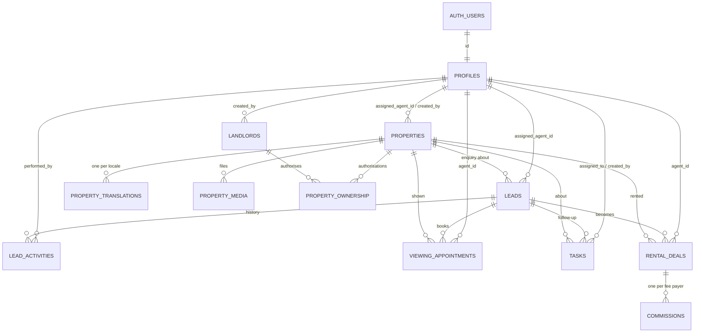

# Database design

Source of truth: the SQL in `supabase/migrations/` (applied in filename order).
Generated TypeScript types: `src/types/database.ts` (`npm run db:types`).

| Migration | Contents |
|---|---|
| `20261011090000_types_and_helpers.sql` | Enum types, `private` schema, `updated_at` trigger, safe default privileges |
| `20261011090100_core_tables.sql` | `profiles`, `landlords`, `properties`, `property_translations`, `property_media`, `property_ownership` |
| `20261011090200_crm_tables.sql` | `leads`, `lead_activities`, `viewing_appointments`, `tasks`, `rental_deals`, `commissions` |
| `20261011090300_security_rls.sql` | Role helpers, guard triggers, grants, RLS policies, `set_staff_role()` |
| `20261011090400_public_views_and_storage.sql` | Public views, storage buckets and storage policies |
| `20261011100000_public_site_support.sql` | `public_properties.created_at`, `leads.enquiry_message`, `landlord_submissions` (staff-only) |
| `20261013090000_lead_stage_values.sql` | Adds lead statuses `reserved`, `unresponsive`, `on_hold`, `cancelled` |
| `20261013090100_crm_dashboard.sql` | Lead requirement columns, history columns and trigger, `staff_names`, `crm_lead_list`, dashboard functions |
| `20261014090000_deal_stage_values.sql` | New deal statuses and the `other` fee payer |
| `20261014090100_finance_schema.sql` | Deal terms and commission arrangement, receivable ledger, agent payouts, expenses, documents, audit log, money triggers |
| `20261014090200_finance_security.sql` | Access rules, `commission_balances` / `deal_financials` / `deal_overview` views, `finance_report()`, private-document storage policies |

## Relationships

## Conventions

- **Keys**: UUID primary keys (`gen_random_uuid()`), UUID foreign keys.
- **Delete behaviour**: every foreign key is `ON DELETE RESTRICT`, except
  `property_translations` and `property_media`, which cascade from their
  property (content with no meaning on its own). Properties are never hard
  deleted: `archived_at` is set and `publication_status` becomes `archived`
  (a CHECK keeps the two in agreement). Staff are deactivated (`is_active`),
  not deleted. No role holds `DELETE` on business tables.
- **Money**: `NUMERIC(18,0)` columns named `*_minor` holding integer minor
  units (USD cents, KHR riel) beside a `currency` column, as required by the
  project rules. Rent (`agreed_monthly_rent_minor`) and agency revenue
  (`commissions.agreed_amount_minor`) live in different tables and are never
  summed.
- **Allowed values**: Postgres enums (`staff_role`, `publication_status`,
  `lead_stage`, `deal_stage`, ...). Property enums mirror
  `src/types/property.ts`.
- **Timestamps**: `created_at` / `updated_at` as `timestamptz`; `updated_at` is
  set by a trigger, not by clients.
- **Append-only history**: `lead_activities` rejects UPDATE and DELETE (trigger)
  for every role.

## Differences from the Step 2 brief

| Brief | Implemented | Why |
|---|---|---|
| `monthly_rent`, `deposit_amount` | `monthly_rent_minor`, `deposit_amount_minor` | Project rule: integer minor units plus currency |
| `budget_min`, `budget_max` | `budget_min_minor`, `budget_max_minor` | Same |
| `agreed_monthly_rent`, `agreed_amount`, `amount_paid` | `*_minor` | Same |
| `landlords.full_name` or `business_name` | both columns, `full_name` required | A company contact still needs a person |
| `role` on profiles | `role staff_role` | Typed enum |
| *(not listed)* `properties.available_from` | added | The `available_from` availability status needs a date |
| *(not listed)* `landlords.created_by`, `landlords.archived_at` | added | Lets an agent see landlords they registered; soft archive |
| `leads.source` free text | `lead_source` enum | Explicit allowed values; campaign stays free text |
| `commissions.agreed_rate` | percent *or* number of months, per `calculation_type` | `percentage_of_rent`, `months_of_rent`, `fixed_amount` |
| Role `owner` (blueprint) | `super_admin` | Name given in the Step 2 brief; same meaning |

Not in this step (deferred): teams (`team_id`), `audit_log`, `documents`,
`marketing_authorizations` documents, offers/leases, commission splits and
payouts, shortlists. The blueprint lists them for later phases.

## Public surface

`anon` has **no** privileges on any table. The website reads three views owned
by the migration role (they run with the owner's rights on purpose, so a fixed
column set of qualifying rows can be exposed without table access):

- `public_properties`: published, not archived, availability `available` or
  `available_from`. Excludes address, coordinates, agent, creator.
- `public_property_translations`, `public_property_media`: only rows of
  properties in `public_properties`.

Supabase's linter reports these as "security definer views"; that is expected.
Adding a column to `properties` does **not** make it public: the view lists
columns explicitly.
